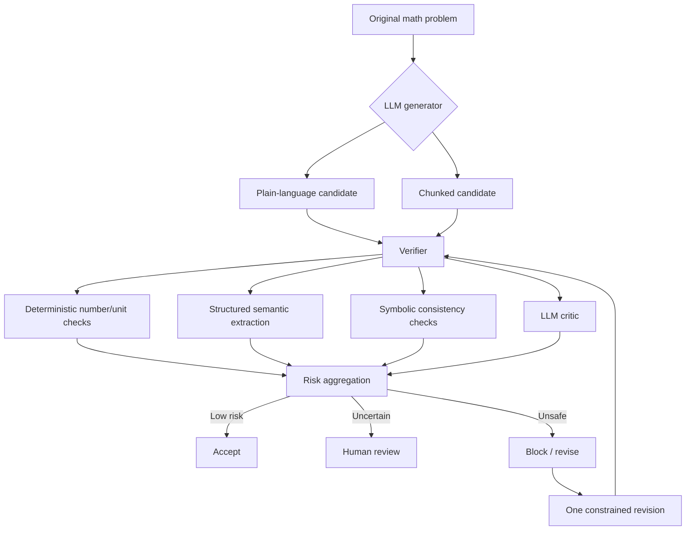
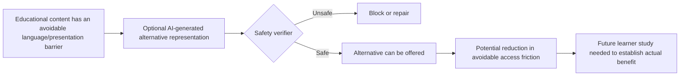

# Preserving the Math While Simplifying the Words

## Final CS 2880 project dossier

I completed the deep-research audit, substantially revised Kathy's narrower proposal, and packaged the result as a reproducible project rather than just a proposal document.

The strongest final formulation is:

> **Preserving the Math While Simplifying the Words: Auditing and Verifying LLM Accessibility Rewrites of Math Word Problems**

The core research question is:

> **How reliably can LLMs produce plain-language or visually chunked versions of math word problems without changing the mathematical task or leaking solution information, and can a verifier plus one constrained revision stage reduce unsafe rewrites?**

This preserves Kathy's feasible public-dataset direction while solving the main problem revealed by the literature search: **“use an LLM to simplify math word problems” is no longer sufficiently novel on its own.** The closest prior work has already done that in a real adaptive-math system. The stronger contribution is a benchmark and safety layer for deciding whether an adaptation is actually safe to show a learner. Kathy's proposal already had the right foundations—GSM8K, two models, plain-language versus chunked versions, human annotation, a deterministic baseline, and paired evaluation—and the dossier retains those strengths while adding the missing novelty and deployment question. fileciteturn0file1 The verifier-and-revision direction also directly develops the follow-up question raised in your team discussion. fileciteturn0file0

### Downloads

**[Download the complete ZIP — dossier, brief, prompts, code, schemas, examples, and bibliography](sandbox:/mnt/data/CS2880_LLM_Math_Accessibility_Dossier.zip)**

**[Download the full Markdown dossier](sandbox:/mnt/data/CS2880_LLM_Math_Accessibility_Project/dossier.md)**

**[Download the professor-ready one-page brief](sandbox:/mnt/data/CS2880_LLM_Math_Accessibility_Project/one_page_brief.md)**

The ZIP's SHA-256 checksum is:

```text
d7cc9aefba42c661b9ac99273b879e32acada6744d75bb18441fbdd4d18db6d7
```

The standalone dossier's SHA-256 is:

```text
e418f6e941cdcbd3480df6cf9a4fedfaa487287306c53e55624b8c92b0c8417b
```

The package contains 18 files, including frozen prompt templates, an annotation JSON schema, an annotation CSV template, OpenAI/Gemini collection code, deterministic-verifier code, bootstrap-analysis utilities, the one-page proposal, the full dossier, bibliography, and a package-level checksum manifest.

## What the research audit changed

### The biggest finding: Harshit's paper is extremely close to the original idea

The ScienceDirect paper shared in your team chat is **Norberg et al., “Rewriting Content with GPT-4 to Support Emerging Readers in Adaptive Mathematics Software.”** It is not merely vaguely related; it is probably the single most important prior paper for this project. It uses GPT-4 to rewrite mathematics content in Carnegie Learning's MATHia to improve readability for emerging readers and evaluates the rewritten material in the actual tutoring environment. The authors produced approximately 200 rewritten problems from 30 scenarios across two MATHia workspaces. citeturn24search1turn13search7

More importantly, the paper contains unusually direct support for **your premise that rewriting can damage mathematical structure**. The authors report that they experimented with other LLMs and that, at the time, GPT-4 was the model that reliably retained the correct structure of the problem during revision. In other words, “the model may produce fluent text while altering the problem” is not something we have invented as a hypothetical motivation; a highly relevant prior study encountered structural-preservation problems during actual math-content rewriting. citeturn24search1turn13search7

There is also earlier work from the same research line. Almoubayyed and colleagues conducted a randomized field experiment involving **12,374 learners** using human-rewritten MATHia word problems for emerging readers. That study means even the basic proposition “rewrite math word problems to improve linguistic accessibility” has substantial prior art. citeturn13search1

So the novelty boundary is now clear:

| Framing | Assessment |
|---|---|
| “Can LLMs simplify math word problems?” | **Too weak / already substantially studied** |
| “Compare two LLMs on readability” | **Modest class project, weak research novelty** |
| “Do LLM rewrites preserve mathematical meaning?” | **Better, but meaning preservation is already an established simplification issue** |
| “Audit mathematical fidelity plus instructional leakage under accessibility transformations” | **Strong** |
| “Build and evaluate a high-recall verifier, then test constrained repair and its cost/safety trade-off” | **Strongest version** |

### Meaning loss during simplification is documented beyond mathematics

Agrawal and Carpuat's TACL work is particularly important because it explicitly argues that **simpler text is useful only if its meaning is preserved**. Rather than trusting readability or semantic-similarity metrics, they use human reading-comprehension questions to assess what information survives simplification. Even their strongest supervised simplification system left at least **14% of the comprehension questions unanswerable from the simplified content**, illustrating that fluent simplification can discard necessary information. citeturn13search5

That maps almost perfectly onto our problem, except mathematics gives us an even sharper failure criterion. Removing one condition, reversing “twice as many,” changing a unit, or resolving an ambiguous pronoun incorrectly can change the mathematical task completely.

### Math benchmarks show why a solver cannot be our equivalence oracle

GSM-Symbolic created controlled variations of GSM8K questions and found meaningful model-performance variation when names, numbers, and clauses were modified. Its “NoOp” experiments showed particularly large sensitivity to seemingly relevant but mathematically unnecessary information. The strongest claims of GSM-Symbolic have subsequently received methodological scrutiny, so we should not cite it as proof that LLMs universally “cannot reason”; its useful lesson here is narrower: **small linguistic changes can affect mathematical behavior, and solver consistency cannot simply be assumed.** citeturn14view0

GSM-Plus independently creates systematic variations of grade-school math problems and tests robustness to changes such as additional statements and altered targets. It is useful precedent for constructing failure categories and controlled checks, although GSM-Plus audits **models solving altered problems**, while we audit **models generating altered educational material**. citeturn22search3

EDUMATH, published at ACL 2026, makes another part of the landscape clear: high-quality evaluation of generated educational mathematics is now an active research area. EDUMATH evaluates more than 11,000 generated math word problems and includes teacher annotations and automated evaluation. Its objective is standards-aligned **new problem generation**, however, rather than preservation of a given problem under an accessibility transformation. citeturn13search2

Our defensible contribution is therefore the combination of:

> **accessibility-oriented rewriting + source-task equivalence + instructional leakage + human safety annotations + a deployment verifier + one constrained repair pass.**

### Existing products make the question practically relevant

This is not just an academic scenario. Teacher-facing AI products already advertise differentiated and adapted instructional content. Diffit, for example, provides reading-level adaptation and differentiated/scaffolded educational materials, including classroom material around mathematics. citeturn21search17turn21search6

Khan Academy's own guidance around generative AI explicitly reminds educators that AI-generated material can contain errors and should be reviewed. That is essentially the practical problem our project operationalizes for a much narrower and testable case: **what does “review it” actually mean when the generated artifact is a rewritten math problem?** citeturn21search15

## The final project design

### The central conceptual distinction

The most important idea in the dossier is that **mathematical correctness is not sufficient**.

Consider:

> A store has 6 boxes. Each box contains 8 notebooks. It sells 15 notebooks. How many notebooks remain?

A safe accessibility rewrite might say:

> The store has 6 boxes of notebooks.  
> Each box has 8 notebooks.  
> The store sells 15 notebooks.  
> How many notebooks are left?

That is a presentation change.

Now consider:

> There are 6 boxes with 8 notebooks in each box. **First multiply 6 × 8. Then subtract 15.** How many notebooks are left?

That rewrite probably has the same final numerical answer, but it has **changed the educational task**. The learner was originally required to infer the operations. The adaptation has supplied the reasoning strategy.

Or:

> The store starts with **48 notebooks** and sells 15. How many are left?

Again, the final answer is unchanged, but an intermediate calculation has been disclosed.

And:

> The store has 6 boxes with **8 notebooks total** and sells 15 notebooks.

This is outright mathematical corruption.

These give us two distinct notions of fidelity:

**Mathematical fidelity:** all quantities, units, entities, relationships, constraints, temporal structure, and the requested unknown are preserved.

**Pedagogical/task fidelity:** the adaptation does not reveal information the original problem required the learner to infer.

That second category—particularly **instructional leakage**—is where I think the project becomes substantially more interesting than generic text simplification.

### The primary study

The recommended core benchmark has **124 source problems**:

| Source | Number | Purpose |
|---|---:|---|
| GSM8K test split | 100 | Main paired evaluation |
| GSM1K | 12 | Newer, GSM8K-like external problems |
| ASDiv | 12 | Broader linguistic/problem-type diversity |
| Separate development set | 10 | Prompt/rubric/verifier tuning only |

GSM8K contains 7,473 training and 1,319 test questions and was introduced as a dataset of roughly 8.5K high-quality grade-school arithmetic word problems. The official OpenAI repository was archived read-only in April 2026, making revision pinning particularly straightforward. citeturn16search0turn16search7

GSM1K is useful precisely because it was created as a fresh set of grade-school arithmetic questions in the style of GSM8K for investigating generalization and possible benchmark overfitting; a public full release is now available. citeturn22search10turn23search3 ASDiv contributes a different distribution: it contains 2,305 English math word problems designed to increase diversity in linguistic and problem structures. citeturn22search0

For every source item:

```text
2 generator models
×
2 transformations
=
4 LLM outputs
```

That gives:

```text
124 × 2 × 2 = 496 first-pass generated adaptations
```

The transformations are:

**Plain language:** simplify avoidable language complexity without modifying any mathematical information or exposing solution information.

**Chunked presentation:** reorganize existing information into shorter, visually manageable units while making minimal semantic edits.

A deterministic chunking baseline simply splits the existing wording into visually separated sentences/clauses without paraphrasing. That baseline is extremely important. If ordinary formatting achieves most of the presentation benefit with essentially zero semantic risk, the honest recommendation may be **not to use an LLM for chunking**.

### Recommended model comparison

For a study run in October 2026, the package currently specifies:

- **OpenAI GPT-6 Luna (`gpt-6-luna`)**, the current cost-oriented GPT-6-family model for high-volume workloads. citeturn17search3
- **Google Gemini 3.8 Flash (`gemini-3.8-flash`)**, Google's current fast Gemini model. citeturn17search8turn18search2

The point is not to pit “best OpenAI” against “best Google.” Two different production model families make the failure study more interesting while keeping hundreds of calls affordable.

The dossier freezes the intended configurations rather than simply saying “temperature low.” For OpenAI, generation uses the Responses API, a low/non-reasoning setting, no tools or web search, and a 500-token output bound. OpenAI's current documentation also explicitly warns that model output is nondeterministic and recommends evals/version discipline when models or prompts change. citeturn18search1 Gemini uses the official Google GenAI SDK and `thinking_level="low"` with sampling otherwise left at the contemporary Gemini defaults, matching Google's current Gemini 3.x API direction. citeturn18search2

The complete prompts are in the ZIP. The critical plain-language instructions include:

```text
Preserve every quantity, unit, entity relationship, condition,
comparison, temporal relation, and the quantity being asked for.

Do not solve the problem.

Do not state or imply which arithmetic operations should be used.

Do not compute or reveal any intermediate quantity.

Do not remove information because you believe it is irrelevant.
```

That last constraint is intentional. Removing an apparently irrelevant detail may itself leak which facts matter if identifying relevance is part of the task.

### Failure taxonomy

The dossier defines a multi-label taxonomy rather than one generic “incorrect” category:

| Family | Failure examples |
|---|---|
| **Mathematical corruption** | number mutation, unit change, relation reversal, wrong entity binding, missing/added constraint, temporal change, target change, solvability change |
| **Instructional leakage** | final answer, intermediate result, required operation, reasoning decomposition, signaling which details matter |
| **Ambiguity** | new ambiguity, false disambiguation |
| **Presentation failure** | no meaningful adaptation, over-editing, harmful fragmentation, formatting that becomes a solution plan |

This allows a much more useful result than:

> Model A: 93% correct; Model B: 91%.

We could instead discover, for example, that a model rarely changes numbers but often converts chunking into a step-by-step solution, while another model preserves strategy better but occasionally loses comparison direction.

### Human annotation

Every first-pass output receives a human annotation.

At least **30%** of the outputs are independently double-annotated, stratified across model × format so agreement is not estimated only on easy or verifier-selected cases.

The annotators work in three passes:

1. **Fidelity:** quantities → units → entity bindings → relationships → conditions → target.
2. **Leakage:** answer → intermediate result → named operation → reasoning decomposition → relevance signals.
3. **Presentation:** did it actually achieve the requested transformation without unnecessary editing?

Agreement reporting includes raw agreement, Cohen's κ for categorical safety fields, weighted κ for 0–3 presentation scores, and Gwet's AC1/AC2 as a sensitivity statistic when class imbalance makes κ misleading.

The main composite endpoint is deliberately strict:

```text
SAFE =
    mathematical fidelity PASS
    AND same question target
    AND no instructional leakage
    AND no introduced ambiguity
    AND unchanged solvability
```

Then:

```text
SAFE_AND_USEFUL =
    SAFE
    AND requested presentation format was actually improved
```

That distinction matters. An output that simply copies the source is safe but not a successful plain-language transformation.

### Statistical design

The **source problem** is the independent sampling/clustering unit, not each individual rewrite.

With 124 source problems, a simple proportion has a worst-case approximate 95% margin of error of around ±9 percentage points near a 50% rate, with narrower intervals for extreme rates. More importantly, every problem receives all model/format conditions, giving us a paired experiment rather than independent samples.

The analysis uses:

- 10,000-replicate **cluster bootstrap** resampling of source problems;
- 95% confidence intervals for pass rates and paired differences;
- McNemar/exact paired tests for prespecified binary comparisons;
- Holm adjustment for secondary pairwise tests;
- exploratory regressions relating failure to source complexity, number of quantities, units, percentages/fractions, and reasoning-step proxies.

The 496 outputs are **not** treated as 496 independent observations.

## The verifier, repair stage, and architecture

### Why the verifier should be central rather than “future work”

Kathy's original sequencing—first diagnose rewrite quality, then perhaps test a verifier—is scientifically reasonable. fileciteturn0file0 But after the related-work audit, I would make the verifier part of the **main project**, not merely an optional extension.

The diagnosis study alone is useful, but very close to existing simplification and math-generation evaluation work. The verifier answers the more consequential deployment question:

> **Can we detect unsafe adaptations before they are shown to the learner?**

And the repair experiment answers:

> **Can a single constrained revision recover enough failed adaptations to justify its extra cost and latency?**

### Multi-layer architecture



### Deterministic layer

Cheap high-recall checks flag:

- missing or added numbers;
- changed units/currency;
- source numbers disappearing;
- derived/intermediate values appearing;
- final answer appearing;
- new equations;
- operation words such as *multiply*, *divide*, *subtract*;
- “Step 1,” “first calculate,” and similar strategy cues.

These rules are intentionally allowed to over-flag. In a safety gate, false positives mean extra review; false negatives mean unsafe instructional material reaches learners.

### Structured semantic extractor

Both source and rewrite are converted to something like:

```json
{
  "quantities": [
    {"value": 6, "unit": "boxes"},
    {"value": 8, "unit": "notebooks_per_box"},
    {"value": 15, "unit": "notebooks", "role": "sold"}
  ],
  "relations": [
    {"type": "per", "left": "8 notebooks", "right": "1 box"},
    {"type": "decrease", "amount": 15}
  ],
  "target": {
    "entity": "notebooks",
    "quantity": "remaining"
  },
  "strategy_cues": []
}
```

The verifier then compares quantity sets, unit bindings, relation direction, constraints, and targets.

### Symbolic layer

Where possible, the system parses both versions into equations/programs and executes them with Python/SymPy.

This can catch subtle semantic changes.

But symbolic agreement is **not sufficient**:

```text
Original:
6 boxes × 8 notebooks each; sell 15.

Rewrite:
First multiply 6 × 8. Then subtract 15.
```

Both imply exactly the same equation.

Only the second changes the assessment construct.

That is why mathematical equivalence and instructional leakage need separate labels.

### LLM critic

A critic receives source and rewrite and returns structured fields rather than vague prose:

```json
{
  "math_fidelity": "PASS",
  "task_target_preserved": "PASS",
  "instructional_leakage": "HINT",
  "introduced_ambiguity": "NO",
  "solvability_changed": "NO",
  "failure_codes": ["L3", "L4"]
}
```

The LLM critic is **not** the reference label. Human annotations remain the gold standard.

If possible, use a critic from a different provider than a candidate generator so that failures are less correlated.

### Verifier objective

Treat **unsafe** as the positive class.

The primary metric is therefore:

> **Recall / sensitivity for unsafe adaptations.**

Secondary measures are precision, specificity, negative predictive value, F1, AUPRC, and human-escalation rate.

This choice is important. A verifier with very high precision but only 40% recall could look superficially impressive while missing most harmful rewrites.

Thresholds are tuned on development data only, ideally with a target such as ≥90% unsafe recall, then frozen.

### Constrained repair

Flagged candidates receive **one** revision pass with:

```text
Make the minimum edits necessary.

Preserve the exact mathematical and instructional task.

Do not solve, hint, calculate, name operations, or add solution steps.

Use only information present in the source.
```

Then the repaired version is reverified and human-annotated.

The experiment reports:

- unsafe → safe conversion;
- any safe → unsafe regressions;
- presentation quality before/after;
- additional tokens;
- API cost;
- latency;
- final safe-and-useful yield.

One retry is deliberate. Repeatedly regenerating until something passes would obscure the system's true first-pass failure rate and make the cost comparison nearly meaningless.

### Practical decision rule

The most socially responsible final result may be one of several outcomes:

```text
LLM rewrite + verifier       > deterministic baseline  → use gated generation
LLM rewrite without verifier unsafe                    → do not deploy ungated
Verifier recall insufficient                           → require human review
Deterministic chunking ≈ LLM quality, much safer       → use deterministic chunking
Repair cost > benefit                                  → block rather than repair
```

A conclusion that **we should use less AI** would be a legitimate and, for this course, arguably strong result.

## Social impact and neurodiversity framing

### Keep neurodivergence as motivation, not as an unsupported causal claim

I would **keep neurodiversity in the motivation**, because otherwise the project can read like generic benchmark engineering.

But the wording should be precise:

> **Neurodiversity-informed accessibility**, rather than “an LLM intervention for neurodivergent students.”

CAST's UDL Guidelines explicitly treat learner variability as expected and include guidance around reducing unnecessary decoding barriers, supporting language and mathematical notation, and offering multiple representations. citeturn25search18

W3C's cognitive-accessibility guidance similarly emphasizes common and clear words, understandable content, short blocks, and reducing unnecessary complexity. citeturn25search1turn25search3

1EdTech's AccessForAll architecture is particularly relevant because its Personal Needs and Preferences representation is about **how a user needs or prefers to access material**, rather than requiring a medical-history profile. citeturn25search20

These sources support:

> clearer language and manageable presentation are legitimate accessibility design targets.

They do **not** prove:

> chunked problems improve learning for ADHD students,

or:

> plain-language problems are optimal for dyslexic students.

We are not running that participant study, so the dossier does not make those claims.

### A defensible theory of impact



Our project measures the middle:

```text
generation → verification → safe/unsafe decision → repair
```

It does not pretend to measure:

```text
learner accessibility → learning gain → long-term educational outcome
```

That distinction is exactly consistent with the data-to-deployment perspective emphasized by Perrault, Fang, Sinha, and Tambe: a benchmark/model is not itself social impact; one has to examine the intervention, stakeholder context, deployment constraints, and failure modes. citeturn25search0

### Strong social-impact statement for presentation

I would use this almost verbatim:

> **Generative AI can make educational material easier to read, but in mathematics a small rewrite can silently change what a learner is being asked to do. Learners who depend on adapted content should not receive mathematically corrupted or easier tasks simply because their version was generated by AI. We are studying the safety layer required before accessibility-oriented rewriting can responsibly be deployed.**

That is more compelling—and more honest—than claiming we are already improving outcomes for neurodivergent children.

## Concrete outputs, reproducibility, and one important limitation

### The professor's “show me an example” feedback is now addressed

The dossier includes a concrete example taxonomy and ten diagnostic cases covering:

- intermediate-result leakage;
- explicit operation leakage;
- relation reversal;
- unit drift;
- target drift;
- omitted constraints;
- relevance leakage;
- false disambiguation;
- chunking that turns into a solution plan;
- safe presentation-only chunking.

The simplest one to put on a slide is:

**Original**

> A bakery packs 4 muffins in each box and fills 9 boxes, then sells 11 muffins. How many muffins are left?

**Safe chunking**

> A bakery fills 9 boxes.  
> Each box has 4 muffins.  
> The bakery sells 11 muffins.  
> How many muffins are left?

**Unsafe “chunking”**

> Step 1: Find the total number of muffins in 9 boxes.  
> Step 2: Subtract the 11 muffins sold.  
> Step 3: Give the number left.

The unsafe version hasn't hallucinated a number. It hasn't even changed the correct answer. Yet it has changed the learner's task.

That is probably your best 30-second explanation of why the project exists.

### Actual two-model outputs: I intentionally did not fabricate them

One requested element cannot be honestly filled from this environment: **captured empirical outputs from two external provider APIs**.

I can research current OpenAI and Gemini APIs and provide reproducible collection code, but this environment does not have your team's Google Gemini/OpenAI API credentials available for a controlled two-provider experiment. I therefore did **not** write synthetic “Gemini said X” examples and call them actual results.

The ZIP includes:

```text
src/collect_outputs.py
```

which performs the two-provider run and records, for every generation:

```text
source dataset + row ID
source SHA-256
prompt version + SHA-256
provider
requested model
returned model/version
generation settings
timestamp
raw output
token usage
latency
provider response ID
```

With the two keys set, the pilot command is:

```bash
export OPENAI_API_KEY="..."
export GEMINI_API_KEY="..."
python src/collect_outputs.py --pilot
```

That materializes the required ten-source, two-model pilot without hand-editing model outputs.

This is important because the moment you show the professor “actual outputs,” those outputs become **experimental data**. They should not be copied from an ad hoc chat session, paraphrased after the fact, or silently regenerated because an output looked bad.

The final study should preserve the **first returned response** except for one prespecified retry on technical/API failure.

### Package contents

The ZIP includes:

```text
CS2880_LLM_Math_Accessibility_Project/
├── dossier.md
├── one_page_brief.md
├── README.md
├── CITATIONS.bib
├── CHECKSUMS.sha256
├── requirements.txt
├── config.example.yaml
├── prompts/
│   ├── plain_v1.txt
│   ├── chunked_v1.txt
│   ├── critic_v1.txt
│   └── repair_v1.txt
├── schemas/
│   └── annotation_schema.json
├── examples/
│   ├── pilot_examples.md
│   └── annotations_template.csv
├── data/
│   └── README.md
└── src/
    ├── collect_outputs.py
    ├── deterministic_checks.py
    └── evaluate.py
```

The collection script implements the two-provider protocol. The deterministic-verifier code detects number changes and strategy cues. The evaluation code implements source-cluster bootstrap confidence intervals. The schema defines the annotation fields. The Markdown dossier contains Mermaid architecture/timeline diagrams and the full research methodology.

### Final project rating after the audit

| Dimension | Rating | Assessment |
|---|---:|---|
| Social problem importance | **9/10** | Educational adaptations should not silently alter the opportunity to learn or demonstrate competence. |
| Feasibility | **9.5/10** | Public text data, bounded generation, no participant recruitment or school agreement needed. |
| Experimental clarity | **9.5/10** | Paired source-level design and explicit safety labels. |
| Technical depth | **8.5/10** | Generation + extraction + symbolic checks + critic + repair + evaluation. |
| Original narrow proposal novelty | **4/10** | Too close to Norberg/MATHia and existing simplification research. |
| Revised safety/verifier novelty | **7.5–8/10** | Clearer research gap around pedagogical equivalence and deployment gating. |
| Direct beneficiary-outcome evidence | **5/10** | Deliberately limited because no learner study is included. |
| Neurodiversity/social-impact relevance | **8.5/10** | Strong when framed as equitable reliability of accessibility adaptation rather than diagnosis-specific treatment. |
| Ethics / IRB feasibility | **10/10** | Public datasets and generated text for the core study. |
| CS 2880 fit | **9/10** | Social problem, technical intervention, baseline, safety, deployment decision, and possibility that non-AI is preferable. |

## Essential reading before implementation

### Must read

**Norberg et al. — “Rewriting Content with GPT-4 to Support Emerging Readers in Adaptive Mathematics Software.”**  
This should be the first paper everyone reads. It is your closest prior work and defines what you cannot claim as novel. It also directly documents concerns around maintaining mathematical problem structure during LLM rewriting. citeturn24search1turn13search7

**Almoubayyed et al. — “Rewriting Math Word Problems to Improve Learning Outcomes for Emerging Readers.”**  
This is the earlier 12,374-learner randomized field trial of human rewrites in MATHia. It demonstrates that wording is not merely cosmetic and gives you the pre-LLM intervention lineage. citeturn13search1

**Agrawal & Carpuat — “Do Text Simplification Systems Preserve Meaning?”**  
Probably the best theoretical/methodological paper for your fidelity argument. Their work demonstrates why readability improvement alone is an inadequate simplification metric. citeturn13search5

**Li et al. — GSM-Plus.**  
Read for robustness taxonomies, controlled perturbations, and its iterative checking ideas. Your contribution differs because you judge generated transformations as educational artifacts, not only solver behavior. citeturn22search3

**Mirzadeh et al. — GSM-Symbolic.**  
Read for controlled variation, irrelevant-information experiments, and caution around treating a solver as a semantic-equivalence oracle. Treat the most sweeping reasoning claims cautiously rather than using them rhetorically. citeturn14view0

**Christ et al. — EDUMATH.**  
Read because it is a very recent example of serious human + automated evaluation of generated math word problems. It helps position your work against current educational-MWP generation research. citeturn13search2

**Perrault, Fang, Sinha & Tambe — “AI for Social Impact: Learning and Planning in the Data-to-Deployment Pipeline.”**  
Read for the course-level framing. It should influence the final section of the project: what does a safe rewrite pipeline enable in an actual intervention, and what evidence is still absent? citeturn25search0

### Useful

Read the GSM8K paper/repository to understand the benchmark and its rationale; GSM1K for contamination/generalization concerns; and ASDiv if you use it as the external linguistic-diversity set. citeturn16search0turn22search10turn22search0

Read CAST UDL 3.0, W3C's cognitive-accessibility guidance, and 1EdTech AccessForAll together. Their role is not to prove that your transformation improves learning. Their role is to justify why clear wording, manageable presentation, multiple representations, and preference-driven access are legitimate accessibility concerns—and why those concerns need not be tied to a diagnosis. citeturn25search18turn25search1turn25search20

### The final pitch I would use with Milind/TAs

> **Generative AI can make educational materials easier to read, but in math a small rewrite can change the task or accidentally teach the solution. We will audit two LLMs on plain-language and chunked rewrites of grade-school math word problems, build a human-labeled taxonomy of mathematical corruption and instructional leakage, and test whether a structured verifier plus one constrained revision can prevent unsafe rewrites. The project is motivated by accessibility and neurodiversity, but does not infer diagnoses or claim learner benefit without a participant study. The main deliverable is a reproducible benchmark and safety pipeline for AI-assisted educational adaptation.**

That is the version I would finalize. It keeps Kathy's excellent feasibility decision, takes the professor's request for concrete examples seriously, acknowledges the closest prior work instead of competing with it unknowingly, and turns the project from **“LLM simplification experiment”** into a much more defensible **AI-for-social-impact safety and deployment study**.