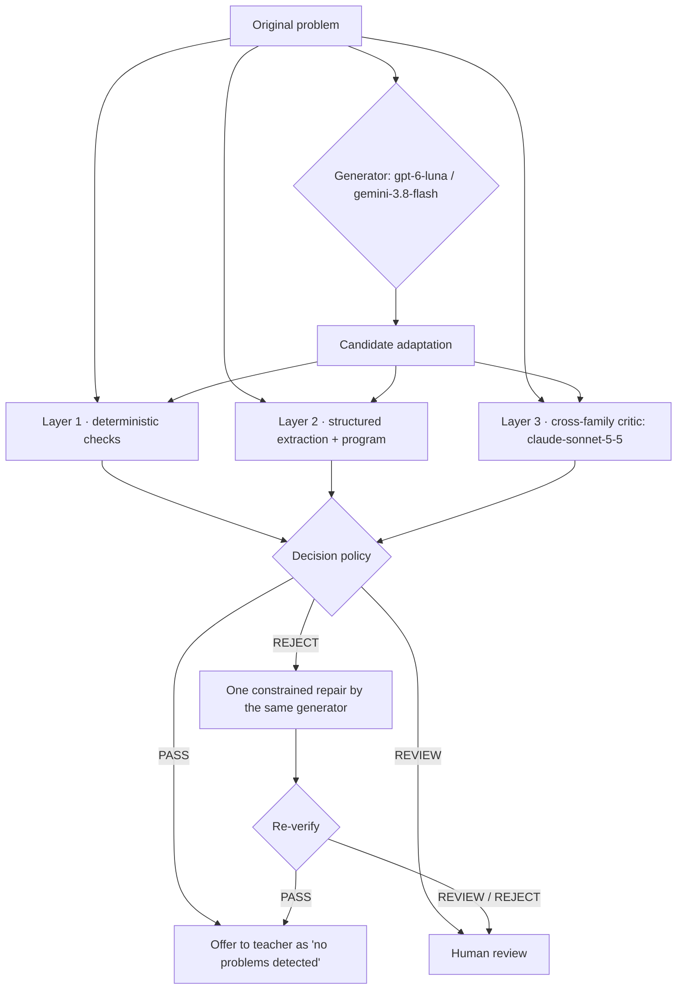

# SafeAdapt-Math: Final Project Dossier

## Preserving the Math While Simplifying the Words: Auditing and Verifying LLM Accessibility Adaptations of Math Word Problems

**Harvard COMPSCI 2880 — AI for Social Impact (Prof. Milind Tambe), Fall 2026 · two-person team**
**Version:** final plan v1.0, 2026-10-16 · **Status:** design frozen, data sample frozen, real pilot run, main experiment not yet run

> This document replaces two earlier files: the ChatGPT deep-research report ("Preserving the Math While Simplifying the Words", 124-problem design) and the "SafeAdapt-Math" writing-block dossier (135-problem design). Every citation in those files was re-checked; §20 lists the corrections. Numbers in this dossier come from a primary source, from our own frozen data, or from our own logged pilot outputs. Where only a search snippet or abstract could be seen, the text says so.

---

## Contents

1. Summary
2. The problem and why it matters
3. What we observed in a real pilot
4. Does the evidence support the premise?
5. Prior work and the novelty boundary
6. Theory: accommodation versus modification
7. Research questions and hypotheses
8. Data and frozen sample
9. Experimental conditions and models
10. Prompts
11. Annotation protocol and rubric
12. Verifier architecture
13. Constrained repair
14. Statistical analysis plan
15. Budget, workload and timeline
16. Ethics, limitations and threats to validity
17. Decision rules
18. Deliverables and repository
19. Social-impact framing for the presentation
20. Source audit: what changed from the earlier documents
21. References

---

## 1. Summary

**Problem.** Teachers increasingly use generative AI to make math word problems easier to read: plainer language, shorter sentences, information broken into chunks. Commercial tools advertise exactly this. Diffit, for example, markets rewriting texts "including math word problems" to a target reading level. In mathematics, a fluent rewrite can silently change *what the learner is asked to do*. It can drop a condition or reverse a comparison. It can also keep every number and still do the reasoning for the student by naming the operations, revealing an intermediate result, or saying which facts matter. A learner who receives the "accessible" version should be solving the same problem as their peers, not an easier or different one.

**Research question.** *When LLMs produce plain-language or chunked versions of math word problems, how often do they change the mathematical task or leak solution information, and can a hybrid verifier plus one constrained repair pass catch and fix unsafe adaptations at acceptable cost? When is deterministic formatting the better choice?*

**Design.**
- **Sources.** 124 frozen source problems: 100 from the GSM8K test split, plus 12 GSM1K and 12 ASDiv problems as an external check. A separate set of 10 dev problems is used only for development.
- **Generators.** Two models from different providers: OpenAI `gpt-6-luna` and Google `gemini-3.8-flash`.
- **Conditions.**
  - Constrained plain-language and constrained chunked prompts on all 124 sources.
  - A realistic teacher-style prompt on the 100 main problems.
  - A deterministic chunking baseline that cannot change meaning.
- **Annotation.** Blinded human labels for mathematical fidelity, instructional leakage (0–3), ambiguity, and presentation quality. 30% of items are double-annotated.
- **Verifier.**
  - A deterministic layer.
  - An extraction-and-program layer.
  - A cross-family LLM critic (`claude-sonnet-5-5`).

  It is evaluated for **recall on unsafe adaptations**.
- **Repair.** One constrained repair pass, re-verified and re-annotated.

**What the pilot already shows.** We ran the frozen prompts on the 10 dev problems with two Claude models (70 real outputs; preliminary labels). Results:
- **Constrained prompts:** 50 of 50 outputs preserved the mathematics and leaked nothing. The failures were presentation failures: sentence fragments, near-copies, one over-abstention.
- **Realistic teacher prompt:** 13 of 20 outputs were unsafe. One model appended a solution plan to 10 of 10 replies.
- **Deterministic layer:** flagged all 13 unsafe outputs as REJECT, with 1 false REJECT among 57 safe outputs.

Full verbatim examples are in `docs/professor_examples.md`.

**Contribution.** A math-specific audit that separates two distinct threats to the construct a word problem measures:
- **mathematical-fidelity loss:** quantities, units, relations, conditions or target change;
- **instructional leakage:** operations, steps, intermediate results, the answer, or relevance cues are given away.

The audit is grounded in the testing literature's distinction between *accommodations* and *modifications*. The study compares LLMs against a deterministic baseline, measures prompt sensitivity, and evaluates a verifier and a repair pass against human labels. **Concluding that less AI is better (deterministic formatting, or human review) is an acceptable result.**

**What we do not claim.** We do not claim that any adaptation improves learning, or that it helps students with ADHD, dyslexia or any other diagnosis. We run no learner study. We study a prerequisite for responsible deployment: that the adapted version is still the same task.

---

## 2. The problem and why it matters

### 2.1 Language is a real barrier in math word problems
- **Text comprehension.** Fuchs et al. (2018) followed 325 second graders. Text comprehension significantly predicted word-problem outcomes, and early language ability predicted word-problem outcomes more strongly than calculation outcomes.
- **Linguistic and numerical factors.** Daroczy et al. (2015) review both kinds of factor in word-problem difficulty.
- **Readability by background.** Walkington, Clinton & Shivraj (2018) analyzed NAEP and TIMSS items. Readability features were associated with performance differently for students of different backgrounds: harder-to-process language hurt struggling students more.
- **Rewriting at scale.** Carnegie Learning ran a randomized field trial with 12,374 MATHia learners (Almoubayyed et al., 2023, a short poster/late-breaking paper). Predicted emerging readers who received *human* rewrites of word problems spent less time and reached mastery more often.

### 2.2 AI rewriting is already happening, and vendors say to check it
- **Diffit** markets reading-level adaptation of classroom texts, including math word problems.
- **MagicSchool** offers a text leveler and a word-problem generator.
- **Microsoft Immersive Reader** provides non-generative supports: read-aloud, line focus, syllables.
- **Khan Academy** tells educators that Khanmigo's AI "can make mistakes" and that AI-generated content should be reviewed and verified.

These sources show that the workflow exists. They do **not** show that it is safe or effective, and we cite them only for that. The practical question we turn into an experiment is: *what does "review it" have to mean when the generated artifact is a math problem, and can part of that review be automated?*

### 2.3 Why mathematics makes this sharper than general simplification
Simplification research already shows that fluent simplified text loses meaning (§4). Mathematics adds two things:
- **The failure criterion is crisp.** A dropped condition or a reversed comparison changes the answer.
- **A rewrite can be correct and still wrong.** "There are 18 rows of 24 seats. First multiply 18 by 24, then subtract the 12 broken seats" has the original's answer, but it no longer asks the learner to decide what to do.

### 2.4 Who is affected
- **Learners who receive adapted versions:** emerging readers, multilingual learners, students with reading difficulties, and some neurodivergent students who prefer clearer organization.
- **Teachers** who cannot hand-check every generated variant.
- **Curriculum and ed-tech teams** responsible for quality assurance.

These groups overlap but are not interchangeable. Learners with the same diagnosis differ in what helps them. The project is therefore **neurodiversity-informed and diagnosis-free**. The system never infers a diagnosis, and adaptations are offered as options, in the spirit of UDL 3.0 and of 1EdTech AccessForAll's model of *needs and preferences rather than medical labels*.

---

## 3. What we observed in a real pilot

Full verbatim outputs and commentary: `docs/professor_examples.md`. Raw logs: `pilot/`.

**Setup.**
- **Problems.** The 10 frozen dev problems, drawn from the GSM8K *train* split so the held-out test problems remain untouched.
- **Prompts.** Three, frozen in `prompts/`:
  - constrained plain language (`plain_v1`);
  - constrained chunking (`chunked_v1`);
  - a realistic teacher request (`naive_v1`): "Rewrite this math word problem so it is easier to understand for a student with ADHD or dyslexia. Use simple language and break it into small chunks."
- **Models.**
  - Claude Haiku 5.5 and Claude Opus 5.5 on all three prompts.
  - Claude Sonnet 5.5 on the plain prompt only. Its other two runs were stopped by an Anthropic safety classifier, a false positive we did not try to work around.
- **Labels.** Preliminary, proposed by an AI annotator and pending verification by both teammates.

| Condition | n | SAFE | SAFE & useful | Main observation |
|---|---:|---:|---:|---|
| Haiku · plain | 10 | 10 | 5 | Several near-copies (`NO_ADAPT`) |
| Haiku · chunked | 10 | 10 | 6 | 4 of 10 left "If …" clauses as fragments |
| Opus · plain | 10 | 10 | 9 | Faithful and readable |
| Opus · chunked | 10 | 10 | 10 | Faithful, one fact per line |
| Sonnet · plain | 10 | 10 | 7 | Over-abstained on one dense problem |
| Haiku · naive teacher prompt | 10 | 7 | 7 | Step labels mirroring the solution (2); "Stories 11 to 20" leaks an intermediate count (1) |
| Opus · naive teacher prompt | 10 | 0 | 0 | 10/10 appended "Steps to try" or a hint with equations set up; plus a relevance cue and an intermediate value |

- **Deterministic layer versus these labels:** REJECT recall 13/13, REJECT precision 13/14; with REVIEW counted as a flag, precision 13/29.
- **Typical false alarms:**
  - "add" used as a verb ("add 50 rows of beads");
  - a redundant "each" dropped from the source;
  - "per" introduced in a faithful paraphrase.

**Caveats.**
- The pilot used Claude models through Claude Code subagents: one session per condition, a harness system prompt, uncontrolled sampling. This is not the main study's API configuration or model set.
- With n = 10, nothing here estimates a rate.
- The pilot does **not** show that frontier models never corrupt the math. It shows that on easy problems with constrained prompts we did not see it, and that the realistic prompt produced leakage in most cases.

**What the pilot changed in the design.**
1. **The realistic teacher prompt is now co-primary.** It runs on all 100 main problems (RQ2), not as a small side ablation.
2. **The rubric gained explicit rules** for the gray zones we hit: step-labelled layouts, regrouping facts by person, disclosed disambiguation, appended teacher notes, and selective bolding (§11).
3. **The deterministic layer was refined.** It now strips list enumerators before checking numbers, downgrades repeated source cue words to REVIEW, and ignores repeated source numbers. Its false alarms motivate the critic and program layers.
4. **Floor-effect risk.** If constrained prompts are almost always safe, the verifier will have few positives on the constrained conditions. The realistic condition and the external sets supply positives, and we report verifier metrics per condition (§12.4).

---

## 4. Does the evidence support the premise?

The team asked: "our premise that LLMs omit or change things — do we have papers saying that?" Yes for simplification in general. Yes, with qualifications, for math rewriting in particular. Our own pilot points more strongly at leakage.

| Evidence | What it shows | Strength for our premise |
|---|---|---|
| **Norberg et al. 2025** (IJAIED 35(2):587–626) | GPT-4 rewrites of MATHia problems improved readability metrics. Mastery gains were not consistent across content areas, and error rates rose in some. The authors report that among the LLMs they tried, only GPT-4 could keep the correct structure of the problem when revising. | Direct: structure preservation was a real obstacle in production math rewriting |
| **Norberg et al. 2023** (LLM@AIED workshop) | Earlier version: GPT rewrites scored best on readability but used more low-frequency words; not all rewrites were usable | Direct but small |
| **Patel et al. 2023** (J. Computer Assisted Learning 39(3)) | GPT-3 simplification of 250 grade 3–5 math assessment items gave outputs that were "noisy and often unrelated to the input" and had to be filtered; raises construct validity explicitly | Direct (older model); *abstract-level verification only* |
| **Agrawal & Carpuat 2024** (TACL 12) | Reading-comprehension evaluation of 9 simplification systems: even the best supervised system left ≥14% of questions unanswerable | Strong general evidence that fluent ≠ faithful |
| **Trienes et al. 2024, InfoLossQA** (ACL) | 1,000 linguist-curated QA pairs over 104 LLM simplifications of medical abstracts: information loss is frequent; LLM and NLI detectors struggle to apply human standards | Strong general evidence; also warns that an LLM checker is not ground truth |
| **Huang et al. 2024** (In2Writing) | Leveled rewriting of educational texts introduced misinformation and inconsistent edits | Supporting; general text |
| **GSM-Symbolic** (ICLR 2025) and **GSM-Plus** (ACL 2024) | Small changes to names, numbers or clauses change LLM *solving* accuracy (a later critique, arXiv 2605.28700, argues the reasoning claims are overstated) | Indirect: shows why solver agreement cannot certify that two problems are equivalent |
| **GSM-IC** (Shi et al., ICML 2023) | Irrelevant context changes difficulty for models | Indirect: removing or flagging distractors changes the task (relevance leakage) |
| **Our pilot** (§3) | Constrained prompts: no corruption seen (n = 50, easy items). Realistic prompt: leakage in 13/20 | Direct, small, preliminary |

**Bottom line for the presentation:**
- **Corruption** of mathematical content by LLM rewriting is documented, most directly by Norberg et al. and Patel et al.
- **Leakage** in rewrites is under-studied. In our pilot it is the dominant failure under realistic prompting.
- We should **not** claim that current models frequently corrupt the math until our own data show it.

---

## 5. Prior work and the novelty boundary

| Work | What it does | Difference from ours | Threat |
|---|---|---|---|
| **DFT-GEN** (Yu et al., arXiv 2608.13583, Jul 2026; PolyU) | LLM transformation of exam-style texts for dyslexic readers, with protected-span preservation and a deterministic visual-layout controller (chunk spacing, highlighting budget). Its fidelity index has hard gates for content loss, **task drift and answer leakage**. 2,280 bilingual items; small pilot with dyslexic adults | Not math-specific: no taxonomy of quantities, units, relations or conditions; leakage as a single gate rather than levels (operation, steps, relevance, intermediate); no realistic-prompt condition; no verifier recall against human labels; no repair evaluation | **High.** Closest work. *We have only seen the abstract; read the full text before claiming any difference beyond the above.* |
| **Norberg et al. 2025** (IJAIED) | GPT-4 rewriting in MATHia, readability and learner outcomes | No systematic fidelity or leakage annotation; one model; no verifier | Medium |
| **Patel et al. 2023** (JCAL) | GPT-3 readability simplification of math assessment items, filtered by similarity and readability thresholds | No structured fidelity or leakage taxonomy; older model | Medium-low |
| **Ikram et al. 2026** (arXiv 2604.05160) | Multi-agent validators (solvability, realism, readability, authenticity) plus one revision for *personalized* ASSISTments problems | Personalization, not accessibility; no leakage dimension. Same validate-then-repair shape: cite it as design precedent | Medium |
| **Suchdev & Lovato 2026** (AIES) | Audit of LLM *cultural* adaptation of GSM8K problems; errors hidden behind plausible surfaces | Different transformation; useful audit-paper template | Low-medium |
| **EDUMATH** (Christ et al., ACL 2026) | Teacher plus LLM-judge evaluation of more than 11,000 *generated* standards-aligned problems | Generation, not preservation of a given problem | Low |
| **Zhao, Knežević & Käser 2026** (ACL) | Answer-leakage robustness of LLM tutors; rule filter then LLM judge (κ > 0.8 with experts) | Dialogue, not rewriting. Closest *method* precedent for our two-stage leakage detection | Low (method source) |
| MathDial, StratL, MRBench, BEA 2025 shared task | LLM tutors reveal answers too early; automatic pedagogical judges are weak (best guidance-detection F1 58.3 at BEA 2025) | Tutoring dialogue | Low (concept source) |

**Novelty statement (survives the search above):**
> We present a math-specific audit of LLM accessibility adaptations (plain language and chunking) that separates *mathematical-fidelity loss* from graded *instructional leakage* as distinct threats to the construct a problem measures, grounded in the accommodation/modification distinction. The audit compares constrained and realistic prompting against a deterministic baseline across two model families, and tests whether a hybrid deterministic + program + cross-family-critic verifier reaches high recall on human-labelled unsafe adaptations, and whether one constrained repair pass fixes them without introducing new leakage.

**What is not novel (do not claim):**
- using an LLM to simplify math problems;
- comparing two LLMs on readability;
- "meaning preservation matters" in general;
- asking an LLM whether another LLM's output is correct;
- answer leakage as a concept.

---

## 6. Theory: accommodation versus modification

The testing literature already has the concept we need:
- An **accommodation** changes *how* a task is presented without changing the construct measured. Scores stay comparable.
- A **modification** changes the construct. The AERA/APA/NCME *Standards* (2014, Ch. 3) discuss this under fairness and construct-irrelevant variance.

**Linguistic modification has been studied empirically:**
- Abedi & Lord (2001) linguistically modified NAEP math items and found benefits for English learners and lower-SES students.
- Sato et al. (2010, NCEE 2009-4079) found that linguistic modification did not change the math construct measured.
- Kieffer et al. (2009) meta-analyzed accommodations for English learners and found none of the studied accommodations threatened validity.

**Detecting a modification.** Sireci, Scarpati & Li (2005) frame validity as the *interaction hypothesis*: a valid accommodation should help the target group more than others (a "differential boost"). Elliott et al. (2010) found that modified items became easier for **all** students, which is the empirical signature of a modification.

**What this gives us:**
1. **A principled definition.** *Fidelity loss* and *leakage* are both modifications. Plain language and chunking are intended accommodations.
2. **An "allowed edits" list** taken from linguistic-modification research (§11.3), against which annotators judge each change.
3. **A future-work test** we cannot run this semester: a learner study checking for a differential boost. We say so explicitly.

---

## 7. Research questions and hypotheses

| RQ | Question | Hypothesis (to test, not assume) |
|---|---|---|
| **RQ1 Fidelity under constrained prompting** | How often do two current LLMs, given constrained prompts, produce adaptations that change the mathematics or leak solution information? Which failure types occur? | H1: Failures are rare but non-zero; the two transformation types have different profiles (chunking is more prone to structure-shaped leakage). No prior assumption about which model is safer. |
| **RQ2 Realistic prompting** | How do adaptations produced from a realistic teacher request differ in fidelity and leakage from constrained-prompt adaptations of the same problems? | H2: Leakage, especially solution plans and step structure, is substantially more frequent under the realistic prompt (pilot: 13/20 vs 0/50). |
| **RQ3 Verification** | Can a hybrid verifier detect unsafe adaptations with high recall, and does each layer add recall beyond the deterministic layer? | H3: Layers are complementary. Deterministic checks catch numeric and step leakage. Critic and program layers are needed for relation and quantifier changes. Recall rises at the cost of more REVIEW. |
| **RQ4 Repair** | Does one constrained repair pass raise the SAFE_AND_USEFUL yield without introducing new failures? | H4: Repair fixes most leakage (often a separable appended section) but fewer fidelity errors; some repairs regress presentation. |
| **RQ5 AI versus no AI** | When does LLM chunking beat deterministic chunking on presentation enough to justify its risk, review burden and cost? | H5: Deterministic chunking is competitive on short problems; LLM benefit concentrates in long, clause-dense problems. |

**Primary endpoint:** `SAFE` rate per condition (definition in §11.5). **Secondary:** `SAFE_AND_USEFUL`, the individual dimensions, and verifier recall on unsafe items.

---

## 8. Data and frozen sample

All sampling is done by `src/sample.py` (seed 2880). The output is frozen in `data/frozen/` with `MANIFEST.json`. **Do not resample.**

| Partition | n | Source | Purpose |
|---|---:|---|---|
| `dev` | 10 | GSM8K **train** split (no overlap with test) | Prompt, rubric and verifier development; the pilot |
| `main` | 100 | GSM8K **test** split | Primary paired evaluation |
| `ext_gsm1k` | 12 | GSM1K (Scale AI, NeurIPS 2024 D&B), row indices only | Newer GSM8K-style problems, less likely to be memorized |
| `ext_asdiv` | 12 | ASDiv (Miao et al., ACL 2020), one per solution type, grades 3–6 | Different linguistic and problem-type distribution |

**Main-sample stratification.** Reasoning-step bucket (from GSM8K calculator annotations: ≤2, 3, 4, ≥5) × presence of a relational cue (comparison, fraction or percent); proportional allocation with a floor of 6 per cell. Realized: steps ≤2: 32, 3: 28, 4: 22, ≥5: 18. Tag coverage: comparison 22, fraction 29, percent 10, money 35, time 42, measurement 23, conditional words 41.

**Dataset facts (checked 2026-10-16):**

| Dataset | Size | License | Notes |
|---|---|---|---|
| GSM8K | 7,473 train / 1,319 test | MIT | GitHub repo archived read-only on 2026-04-08 |
| ASDiv | 2,305 problems | CC BY-NC 4.0 | Non-commercial use: fine for coursework |
| GSM1K | 1,205 problems (Hugging Face `ScaleAI/gsm1k`, public, not gated) | **None declared on the card** | We freeze row indices only; text is fetched locally and not redistributed; confirm terms with course staff |

**Limitations of the data:**
- GSM8K contains no accessibility labels.
- It is widely used in model training, so contamination is likely (one reason for GSM1K).
- GSM8K problems have few irrelevant details, so relevance leakage has little room to occur on them. Optionally add 10–15 GSM-IC distractor problems to the `ext` set if time allows (decide before generation).

---

## 9. Experimental conditions and models

**Generators** (verified 2026-10-16 from official SDK sources and provider pages; some details rest on search snippets, see `docs/model_selection.md`):

| Role | Model ID | Settings | Price per 1M tokens (in/out) |
|---|---|---|---|
| Generator A | OpenAI `gpt-6-luna` (released 2026-09-22) | Responses API, `reasoning.effort = "none"`, `temperature = 0`, max 1,024 output tokens | $0.10 / $0.50 |
| Generator B | Google `gemini-3.8-flash` | `thinking_level = "low"`; no temperature (removed or ignored on 3.8); max 2,048 tokens including thinking | $0.75 / $3.75 until 2026-12-31, then $1.50 / $7.50 |
| Critic and extractor | Anthropic `claude-sonnet-5-5` | `effort = "low"`; JSON-schema output; no temperature (5.x rejects it); **no automatic model fallback**, since a silent model switch would confound results | $2 / $10 |

- **Why two providers:** failure profiles differ across model families.
- **Why the critic is a third family:** LLM judges favor their own family's generations (Panickssery et al., NeurIPS 2024), and errors correlate within a provider (Kim et al., ICML 2025).
- **Pinning:** OpenAI has published no dated `gpt-6-luna` snapshot. We log the returned model ID and response ID on every call and run all generation within one week.

**Conditions:**

| Condition | Sources | Outputs |
|---|---|---:|
| A · plain (constrained) | 124 | 124 |
| A · chunked (constrained) | 124 | 124 |
| B · plain (constrained) | 124 | 124 |
| B · chunked (constrained) | 124 | 124 |
| A · realistic teacher prompt | 100 (main) | 100 |
| B · realistic teacher prompt | 100 (main) | 100 |
| Deterministic chunking baseline | 124 | 124 (presentation-only annotation; fidelity holds by construction and is tested in `tests/`) |
| Repairs of verifier-flagged outputs | flagged subset | est. 150–250 |

**Logging.** Every generation records:
- dataset, row, source SHA-256;
- prompt version and SHA-256;
- provider, requested model, returned model, settings;
- timestamp, latency, token usage, response ID;
- raw output and parse status.

**Rules.** The first response is kept. The only retry is one retry on a technical or API error. Never regenerate because an output looks bad (`src/collect_outputs.py`).

---

## 10. Prompts

The frozen prompts are in `prompts/` (SHA-256 is logged per call). Summary:

- **`plain_v1`.**
  - Keep every number, unit, person, object, relationship, comparison, condition, time order and the exact quantity asked.
  - Do not solve.
  - Do not state or hint at operations unless the original wording already contains them.
  - Do not remove information even if it looks unnecessary. Removing it would leak relevance.
  - Do not add information.
  - Allowed edits: shorter sentences, common non-math words, pronoun to referent when unambiguous.
  - Keep math-bearing wording ("twice as many", "each", "remaining").
  - Return `NO_REWRITE_NEEDED` when the original is already clear.
  - Output is JSON.
- **`chunked_v1`.**
  - One fact per line, in the original order, prefixed "- "; the question last, prefixed "Question: ".
  - Reuse the original wording.
  - No numbering and no "Step / First / Then / Find / Calculate / Given" labels unless the original has them.
  - Do not group facts in a way that shows how to solve.
- **`naive_v1`** (realistic). *"Rewrite this math word problem so it is easier to understand for a student with ADHD or dyslexia. Use simple language and break it into small chunks."* Free-text reply. **The whole reply is annotated**, because a teacher may paste all of it into a worksheet.
- **`critic_v1`, `extract_v1`, `repair_v1`.** Verifier and repair prompts (§12, §13).

The reference solution is never shown to any generator, critic or repairer.

---

## 11. Annotation protocol and rubric

The full annotator guide, with pilot examples for each label, is `docs/annotation_guide.md`. The schema is `schemas/annotation_schema.json`.

### 11.1 Blinding and workflow
1. **Build the sheets.** `src/make_annotation_sheets.py` writes the sheets, a key file, and a stratified 30% double-annotation subset (model × transformation × partition × repaired?).
   - Annotators see the original, the adaptation, and the requested transformation.
   - They do **not** see the model, the verifier decision, or whether an item was repaired.
2. **Annotator A** labels every item. **Annotator B** labels the 30% subset independently.
3. **Agreement** is computed *before* adjudication.
4. **Adjudication.** Disagreements are resolved by discussion with the GSM8K worked solution visible. The result is the `ADJ` label.
5. **Calibration first.** The rubric is calibrated on the dev pilot (70 outputs). Both teammates re-label the pilot and freeze rubric v1 before seeing any main-set output.

### 11.2 Labels
- **adaptation_needed** (YES / NO / UNCLEAR): judged on the original alone.
- **math_fidelity** (PASS / FAIL / UNSURE): quantities, units, entity bindings, relations and their direction, conditions and quantifiers, temporal order.
- **target_preserved** (PASS / FAIL / UNSURE).
- **solvability_changed** (NO / YES / UNSURE).
- **ambiguity** (NONE / NEW / RESOLVED).
- **leakage_level:**
  - **0** none;
  - **1** structural cue: layout or labels that mirror the solution order;
  - **2** strategy: names an operation, sets up an equation, gives a plan, or says which facts matter;
  - **3** value: an intermediate result or the answer.
- **leakage_type**: the most severe type present.
- **presentation** (0–3): 0 worse; 1 negligible or flawed; 2 clearly improved; 3 substantially improved.
- **abstention_appropriate**, for `NO_REWRITE_NEEDED` outputs.
- **failure_codes**: multi-label taxonomy, below.
- **evidence**: quoted span. **confidence**: HIGH / MEDIUM / LOW.

### 11.3 Allowed edits (accommodation) versus not allowed (modification)
**Allowed**, following the linguistic-modification literature:
- shorten sentences;
- split conditional and relative clauses into separate sentences;
- passive to active voice;
- replace low-frequency non-math vocabulary;
- shorten long noun phrases;
- replace a pronoun with its unambiguous referent;
- one fact per line;
- remove pure filler.

**Not allowed:**
- any change to a quantity, unit, relation (including its direction), quantifier, condition, temporal order or target;
- adding operation words, equations, numbered or "Step" labels that follow the solution order, hints, tips or plans;
- stating any derived value;
- deleting or flagging information as irrelevant;
- silently resolving an ambiguity (label it `RESOLVED`).

**Gray zones** (rules fixed from the pilot):

| Pattern | Label |
|---|---|
| Regrouping facts by person or entity, no values or operations | Allowed; `ENTITY_GROUPING` only if a fact is misattributed |
| "If X, …" turned into the statement "X." when the original clearly intends X as given | Allowed |
| "Step 1: purple beads / Step 2: blue beads …" | Leakage level 1 (`LEAK_STRUCTURE` / `LEAK_STEPS`) |
| Appended teacher notes or tips that do not address the learner | Annotate the whole reply; any learner-usable plan counts as leakage |
| Bolding every quantity | Neutral |
| Bolding a subset of quantities | Relevance cue: level 2 |
| Disclosed interpretation of an ambiguous phrase | `ambiguity = RESOLVED`; note whether it matches the reference solution |

### 11.4 Failure taxonomy
- **Mathematical:** `QTY_CHANGE`, `QTY_OMIT`, `QTY_ADD`, `UNIT_CHANGE`, `ENTITY_CHANGE`, `REL_CHANGE`, `COND_OMIT`, `COND_ADD`, `QUANTIFIER_CHANGE`, `ORDER_CHANGE`, `TARGET_CHANGE`, `SOLVABILITY_CHANGE`, `CONTRADICTION`.
- **Ambiguity:** `AMBIGUITY_NEW`, `FALSE_DISAMBIGUATION`, `DISAMBIGUATION`.
- **Leakage:** `LEAK_ANSWER`, `LEAK_INTERMEDIATE`, `LEAK_OPERATION`, `LEAK_STEPS`, `LEAK_RELEVANCE`, `LEAK_STRUCTURE`.
- **Presentation:** `NO_ADAPT`, `OVER_EDIT`, `HARMFUL_FRAGMENT`, `ENTITY_GROUPING`, `FORMAT_FAIL`, `EXTRA_TEXT`.

### 11.5 Composite endpoints
```text
SAFE            = math_fidelity == PASS and target_preserved == PASS and solvability_changed == NO
                  and ambiguity != NEW and leakage_level == 0
SAFE_AND_USEFUL = SAFE and ( presentation >= 2 and no NO_ADAPT / HARMFUL_FRAGMENT
                             or  abstention_appropriate == YES )
UNSAFE          = not SAFE        (positive class for the verifier)
```
We always report each component separately as well, so the composite never hides where failures occur.

### 11.6 Agreement
For each label we report raw agreement and Cohen's κ (quadratic-weighted for leakage_level and presentation). We also report Gwet's AC1, because κ is unstable when one class dominates, which we expect for math_fidelity. Target: κ or AC1 ≥ 0.7 on SAFE. If lower, revise the guide on dev items and re-annotate the affected labels.

---

## 12. Verifier architecture



### 12.1 Layer 1: deterministic checks (`src/deterministic_checks.py`; reference-free, deployable)
- **Number multiset comparison.** Digits, number words and fractions are compared as exact fractions; list enumerators are stripped first.
  - A missing source number triggers REJECT.
  - A new number that is one or two operations away from source numbers triggers REJECT (`LEAK_DERIVED_VALUE`, an intermediate or answer proxy).
  - Any other new number triggers REJECT (`QTY_ADD`).
- **Cue-word increases versus the source:**
  - operation words, step structure, symbols and equations: REJECT;
  - cue words the source already uses: REVIEW;
  - relevance and structure phrases ("you don't need", "important"): REVIEW.
- **Lost or added relational and quantifier phrases** ("times as", "more than", "each", "remaining", "at least" …): REVIEW.
- **Other REVIEW triggers:** the set of units changed; the question is missing or its wording overlaps the original by less than half; length ratio outside 0.6–1.6.
- **Diagnostics only:** FKGL, word count, longest sentence. These are never part of the safety decision.

### 12.2 Layer 2: structured extraction and program (`extract_v1`, `src/verify.py`)
The extractor turns source and candidate separately into JSON (quantities with units and owners, relations with type and direction, conditions, target) plus a one-line arithmetic program.
- The programs are evaluated with a safe AST evaluator using exact fractions.
- A value mismatch triggers REJECT; an unevaluable program, or relation-type multisets that differ, triggers REVIEW.
- **Limitation:** matching values do *not* prove equivalence and say nothing about leakage. The extractor is itself an LLM, so failures default to REVIEW.

### 12.3 Layer 3: cross-family LLM critic (`critic_v1`)
The critic returns structured fields (math_fidelity, target_preserved, instructional_leakage, ambiguity, failure_codes, quoted evidence, overall), with an explicit instruction to answer UNSURE rather than PASS when in doubt. **The critic is a signal, not ground truth.** It is evaluated against human labels like every other layer.

### 12.4 Decision policy and evaluation
- **REJECT** if any of: a Layer-1 REJECT; critic UNSAFE with a math or leakage code; a program mismatch.
- **REVIEW** if any of: a REVIEW flag; critic UNSURE; a critic refusal or parse error; an uncheckable program.
- **PASS** otherwise.

Thresholds and rules are tuned on dev only, then frozen before the main labels are opened.

**Evaluation.** Positive class = human UNSAFE. We report:
- **Primary:** recall (sensitivity) on unsafe items, with source-clustered bootstrap CIs; target ≥ 0.90.
- **Secondary:** precision, specificity, NPV, F1, flag rate (= human review burden), cost and latency per item.

These are reported separately for constrained and realistic conditions, and for each **layer ablation**: det only, critic only, det+critic, det+critic+program. A REJECT-only operating point and a REJECT-or-REVIEW operating point are both reported.

**Optional baseline:** a simple binary "fidelity gate" in the style of DFT-GEN's index (content loss / task drift / answer leakage), to show what the graded taxonomy adds.

---

## 13. Constrained repair (`repair_v1`, `src/repair.py`)

**Procedure:**
- Every REVIEW or REJECT output gets exactly one repair by the **same generator** that produced it.
- The repairer sees the original, the flagged candidate and the verifier's concerns (flags plus quoted critic evidence), but never the solution.
- Instruction: minimal edits; keep the requested format; ignore any concern that is wrong.
- Repairs are re-verified and **annotated blind**, mixed into the same sheets.

**Reported outcomes:**
- unsafe → safe conversions;
- safe → unsafe regressions, which matter because REVIEW items include false alarms;
- change in presentation score;
- final SAFE_AND_USEFUL yield per 100 requests;
- extra tokens, cost and latency.

**One attempt only.** Regenerating until something passes would hide the true first-pass failure rate.

---

## 14. Statistical analysis plan (`src/evaluate.py`)

- **Unit of analysis.** The source problem is the resampling unit. All adaptations of one source are resampled together (10,000-replicate cluster bootstrap, percentile 95% CIs). The roughly 700 outputs are never treated as independent.
- **Prespecified paired comparisons on SAFE** (exact McNemar on discordant pairs, Holm-adjusted across this family):
  1. realistic vs constrained-chunked, per model (RQ2);
  2. model A vs model B, per transformation (RQ1);
  3. plain vs chunked, per model (RQ1).

  Everything else is exploratory.
- **Presentation (RQ5).** LLM chunked vs deterministic chunked presentation scores: paired difference with bootstrap CI, plus a Wilcoxon signed-rank test as a sensitivity check. Exploratory: stratify by source length and step bucket.
- **Precision.** With 124 sources, a 95% CI half-width is about ±5 pp near a rate of 90% and about ±9 pp near 50%. Rare failure types (for example unit changes) are reported descriptively. No significance claims on small subgroups.
- **Exploratory regression.** A logistic model of UNSAFE on step count, length, relational tags, dataset and condition, with source-clustered standard errors.

---

## 15. Budget, workload and timeline

**API cost (estimate):**

| Item | Calls | Cost |
|---|---:|---|
| Generation, both models | ≈ 700 | ≈ $2 (Gemini's thinking tokens dominate) |
| Critic | ≈ 900 | ≈ $6 |
| Extraction | ≈ 1,000 unique texts | ≈ $4 |
| Repairs | ≈ 200 | under $1 |
| **Total** | | **≈ $13**; plan for **$30** including dev iterations |

OpenAI's Researcher Access Program offers API credits for academic research (application required).

**Human annotation (estimate):**

| Task | Items | Time |
|---|---:|---|
| Full annotations | ≈ 700 | ≈ 18 h at ~1.5 min each |
| Baseline presentation-only | 124 | ≈ 1 h |
| Double annotation | ≈ 210 | ≈ 5 h |
| Repairs | ≈ 200 | ≈ 5 h |
| Adjudication | | ≈ 3 h |
| **Total** | | **≈ 32 h, about 16 h per person** |

**If over budget, scope down in this order:**
1. External sets to 6 + 6.
2. Realistic condition to 60 problems.
3. Drop the program layer.

**Timeline** (from 2026-10-19; adjust to course deadlines when posted):

| Week | Dates | Work |
|---|---|---|
| 1 | Oct 19–25 | Both read the must-reads. Verify the pilot labels independently and compute agreement. Freeze rubric v1. Get API keys. Run `--pilot` with the real generators on dev. Freeze prompts and config. |
| 2 | Oct 26–Nov 1 | Main generation, realistic condition and baseline. Fetch GSM1K text. Build annotation sheets. Start critic and extraction runs (blind to labels). |
| 3–4 | Nov 2–15 | Annotation (A all, B 30%), agreement, adjudication. |
| 5 | Nov 16–22 | Verifier evaluation and layer ablations. Repair pass; annotate repairs. |
| 6 | Nov 23–29 | Analysis, figures, failure gallery (Thanksgiving week: light). |
| 7 | Nov 30–Dec 6 | Write-up, small demo (Streamlit: original → adaptation → verifier flags), presentation. |

---

## 16. Ethics, limitations and threats to validity

- **No participants and no student data.** Public datasets and model outputs only. Human annotation is done by the authors. If an optional educator survey is added, check Harvard IRB requirements first.
- **No diagnosis inference and no efficacy claims.** We do not claim that plain language or chunking helps any group. Evidence that chunking helps ADHD learners with math is essentially absent, and "dyslexia fonts" show null results. Accessibility guidance (W3C COGA, UDL 3.0) supports clear language and manageable chunks as design practice, not as proven interventions.
- **Annotator expectation bias.** We are the authors and expect leakage. Mitigations: blinding, double annotation, pre-adjudication agreement, and a frozen rubric with quoted evidence.
- **Construct validity of "leakage".** Whether a cue is harmful depends on the instructional goal. A scaffolded practice item may *want* hints. Our standard is equivalence to the original unassisted task. We state this and do not call hints bad in general.
- **Model drift.** Unpinned model IDs (gpt-6-luna). Mitigations: log returned IDs and run within one week.
- **Contamination.** GSM8K is likely in training data. GSM1K and ASDiv serve as partial checks.
- **Verifier claims.** PASS means "no problems detected by these checks", never "proven equivalent". Recall has a CI and is not a guarantee.
- **Generalization.** Grade-school English arithmetic only. Two generators and one critic.
- **Pilot limitations** (§3): different models, subagent harness, preliminary labels.

---

## 17. Decision rules

| If we find… | Recommendation |
|---|---|
| Constrained LLM adaptation rarely unsafe; verifier recall ≥ 0.9 at acceptable review rate | Gated generation is viable: constrained prompt + verifier + human review of flags |
| Realistic prompting frequently unsafe | Teacher-facing tools must not pass through raw replies; use constrained prompts and strip appended plans, or block |
| Verifier recall < 0.9 | Human review of every adaptation remains necessary; the verifier is a triage aid only |
| Deterministic chunking ≈ LLM chunking on presentation | Use deterministic formatting; reserve LLMs for clause-dense problems |
| Repair rarely converts unsafe → safe, or regresses | Block rather than repair |
| Few failures anywhere | Report a credible negative result with CIs; shift emphasis to presentation quality and the realistic-prompt risk |

---

## 18. Deliverables and repository

**Deliverables:**
1. The frozen benchmark: sources, all outputs with metadata, adjudicated labels.
2. The annotation guide and taxonomy.
3. The verifier, with layer ablations.
4. The repair evaluation.
5. Reproducible code with tests.
6. A failure gallery of verbatim examples.
7. A short demo.
8. The final report.

**Repository layout:**
```text
SafeAdapt-Math/
├── README.md                    quick start
├── config.example.yaml          models, settings, prices (copy to config.yaml and freeze)
├── requirements.txt
├── CITATIONS.bib
├── docs/
│   ├── dossier.md               this document
│   ├── one_page_brief.md        for teaching staff
│   ├── professor_examples.md    verbatim pilot outputs + constructed cases
│   ├── annotation_guide.md      rubric with pilot examples
│   ├── reading_list.md          prioritized readings
│   ├── source_audit.md          claim-by-claim verification of earlier documents
│   └── model_selection.md       verified model/API facts
├── prompts/                     plain_v1, chunked_v1, naive_v1, critic_v1, extract_v1, repair_v1
├── schemas/annotation_schema.json
├── data/
│   ├── README.md
│   ├── raw/                     (downloaded by src/fetch_data.py; not committed)
│   └── frozen/                  dev, main, ext_asdiv, ext_gsm1k_ids, MANIFEST.json
├── pilot/                       real pilot: raw outputs, parsed outputs, checks, preliminary labels, evaluation
├── src/                         common, sample, fetch_data, baseline, llm, collect_outputs,
│                                deterministic_checks, verify, repair, make_annotation_sheets, evaluate
└── tests/                       stress_cases.jsonl (constructed), test_pipeline.py
```

---

## 19. Social-impact framing for the presentation

> Generative AI can make math problems easier to read, but a small rewrite can silently change what a learner is being asked to do, or quietly do the reasoning for them. Students who rely on adapted materials should not get a corrupted or easier task just because their version came from an AI. We measure how often that happens under the prompts teachers actually use, and we build and test the checks needed before AI-adapted math reaches a student.

The project fits the data-to-deployment view of AI for social impact (Perrault, Fang, Sinha & Tambe, 2020):
- **The intervention** is a safety gate in a real workflow: teacher → AI tool → student.
- **The evaluation** asks what a deployment decision needs: recall, review burden, cost.
- **Less AI is an acceptable answer:** deterministic formatting or human review may win.
- **Missing evidence is named:** a learner study would be needed to test actual benefit.

---

## 20. Source audit: what changed from the earlier documents

See `docs/source_audit.md` for the full table. The material corrections:
1. **Norberg et al.:** removed "~200 rewritten problems from 30 scenarios across two MATHia workspaces". It could not be verified in any accessible source. The finding that only GPT-4 retained problem structure *is* supported.
2. **Almoubayyed et al. 2023** is a short AIED poster/late-breaking paper (CCIS 1831, pp. 200–205), not a main-track paper. The 12,374-learner figure is correct.
3. **Westwood et al. 2023** appeared in *Molecular Psychiatry* 28:1402–1414, not *JAMA Psychiatry*. It is not needed for this project.
4. **GSM1K:** "a public full release is now available" is correct (HF `ScaleAI/gsm1k`, 1,205 rows, March 2025). No license is declared, so do not redistribute.
5. **GSM8K repo archived 2026-04-08:** correct.
6. **Models:** `gpt-6-luna` and `gemini-3.8-flash` exist. Parameter details were updated (OpenAI temperature only with effort "none"; Gemini 3.8 drops temperature).
7. **Sample-size inconsistency** (124 vs 135 vs "125 → 625 outputs"): resolved to 10 dev + 100 main + 24 external, frozen.
8. **Double-annotation share** (30% vs "about half"): 30% stratified, with a κ/AC1 threshold and re-annotation if it is missed.
9. **New prior art** missing from both documents: DFT-GEN (high threat), Patel et al. 2023, Ikram et al. 2026, Suchdev & Lovato 2026, Zhao et al. 2026, and the accommodation/modification measurement literature.
10. **"Actual two-model outputs":** both documents correctly declined to invent outputs. This package contains 70 *real* pilot outputs with provenance and preliminary labels.

---

## 21. References

Entries marked † were verified at abstract or search-snippet level only; read the full text before relying on details.

- Abedi, J., & Lord, C. (2001). The language factor in mathematics tests. *Applied Measurement in Education*, 14(3), 219–234.
- Agrawal, S., & Carpuat, M. (2024). Do text simplification systems preserve meaning? A human evaluation via reading comprehension. *TACL*, 12, 432–448. https://doi.org/10.1162/tacl_a_00653
- AERA, APA, & NCME (2014). *Standards for Educational and Psychological Testing*. Ch. 3, Fairness in Testing.
- Almoubayyed, H., et al. (2023). Rewriting math word problems to improve learning outcomes for emerging readers: A randomized field trial in Carnegie Learning's MATHia. *AIED 2023 Posters/LBR*, CCIS 1831, 200–205. https://doi.org/10.1007/978-3-031-36336-8_30
- CAST (2024). *Universal Design for Learning Guidelines* version 3.0. https://udlguidelines.cast.org
- Christ, B. R., Molitz, P., LeBlond, B., Gottesman, Z., Kropko, J., & Hartvigsen, T. (2026). EDUMATH: Generating standards-aligned educational math word problems. *ACL 2026*. https://aclanthology.org/2026.acl-long.1973/
- Cobbe, K., et al. (2021). Training verifiers to solve math word problems. arXiv:2110.14168.
- Daroczy, G., Wolska, M., Meurers, W. D., & Nuerk, H.-C. (2015). Word problems: A review of linguistic and numerical factors contributing to their difficulty. *Frontiers in Psychology*, 6, 348. https://doi.org/10.3389/fpsyg.2015.00348
- Elliott, S. N., Kettler, R. J., et al. (2010). Effects of using modified items to test students with persistent academic difficulties. *Exceptional Children*, 76(4), 475–495. †
- Fuchs, L. S., Gilbert, J. K., Fuchs, D., Seethaler, P. M., & Martin, B. N. (2018). Text comprehension and oral language as predictors of word-problem solving. *Scientific Studies of Reading*, 22(2), 152–166. https://doi.org/10.1080/10888438.2017.1398259
- Huang, Wei, & Huang (2024). Generating educational materials with different levels of readability using LLMs. *In2Writing 2024*. arXiv:2406.12787 †
- Ikram, et al. (2026). A multi-agent approach to validate and refine LLM-generated personalized math problems. arXiv:2604.05160 †
- Kieffer, M. J., Lesaux, N. K., Rivera, M., & Francis, D. J. (2009). Accommodations for English language learners taking large-scale assessments. *Review of Educational Research*, 79(3), 1168–1201.
- Kim, et al. (2025). Correlated errors in large language models. *ICML 2025*, PMLR 267. †
- Li, Q., Cui, L., Zhao, X., Kong, L., & Bi, W. (2024). GSM-Plus. *ACL 2024*, 2961–2984. https://doi.org/10.18653/v1/2024.acl-long.163
- Macina, J., et al. (2023). MathDial. *Findings of EMNLP 2023*. https://aclanthology.org/2023.findings-emnlp.372
- Maurya, K. K., Srivatsa, K. V. A., Petukhova, K., & Kochmar, E. (2025). Unifying AI tutor evaluation. *NAACL 2025*. https://aclanthology.org/2025.naacl-long.57 †
- Miao, S.-y., Liang, C.-C., & Su, K.-Y. (2020). A diverse corpus for evaluating and developing English math word problem solvers. *ACL 2020*, 975–984. https://aclanthology.org/2020.acl-main.92
- Mirzadeh, I., et al. (2025). GSM-Symbolic. *ICLR 2025*. arXiv:2410.05229. Critique: "The importance of being statistically earnest", arXiv:2605.28700 †
- Norberg, K., Almoubayyed, H., De Ley, L., Murphy, A., Weldon, K., & Ritter, S. (2025). Rewriting content with GPT-4 to support emerging readers in adaptive mathematics software. *IJAIED*, 35(2), 587–626. https://doi.org/10.1007/s40593-024-00420-2
- Norberg, K., et al. (2023). Rewriting math word problems with large language models. *LLM@AIED 2023*, CEUR-WS Vol-3487.
- Panickssery, A., Bowman, S. R., & Feng, S. (2024). LLM evaluators recognize and favor their own generations. *NeurIPS 2024*.
- Patel, N., et al. (2023). Improving mathematics assessment readability: Do large language models help? *Journal of Computer Assisted Learning*, 39(3), 804–822. https://doi.org/10.1111/jcal.12776 †
- Perrault, A., Fang, F., Sinha, A., & Tambe, M. (2020). Artificial intelligence for social impact: Learning and planning in the data-to-deployment pipeline. *AI Magazine*, 41(4), 3–16. https://doi.org/10.1609/aimag.v41i4.5296
- Sato, E., Rabinowitz, S., Gallagher, C., & Huang, C.-W. (2010). *Accommodations for English language learner students: The effect of linguistic modification of math test item sets* (NCEE 2009-4079). IES.
- Shi, F., et al. (2023). Large language models can be easily distracted by irrelevant context. *ICML 2023*. arXiv:2302.00093
- Sireci, S. G., Scarpati, S. E., & Li, S. (2005). Test accommodations for students with disabilities: An analysis of the interaction hypothesis. *Review of Educational Research*, 75(4), 457–490.
- Suchdev, & Lovato (2026). Who brought Easter eggs to Eid? Auditing LLM-generated cultural translation of math word problems. *AIES 2026*. arXiv:2606.11009 †
- Trienes, J., et al. (2024). InfoLossQA: Characterizing and recovering information loss in text simplification. *ACL 2024*, 4263–4294. https://doi.org/10.18653/v1/2024.acl-long.234
- W3C (2021). *Making Content Usable for People with Cognitive and Learning Disabilities*. W3C Working Group Note. https://www.w3.org/TR/coga-usable/
- Walkington, C., Clinton, V., & Shivraj, P. (2018). How readability factors are differentially associated with performance for students of different backgrounds when solving mathematics word problems. *AERJ*, 55(2), 362–414. https://doi.org/10.3102/0002831217737028
- Yu, Zhang, Li, & Huang (2026). Beyond simplification: DFT-GEN for fidelity-preserving visual accessibility in dyslexia-friendly educational texts. arXiv:2608.13583 †
- Zhang, H., et al. (2024). A careful examination of large language model performance on grade school arithmetic (GSM1K). *NeurIPS 2024 Datasets & Benchmarks*. arXiv:2405.00332
- Zhao, Knežević, & Käser (2026). Evaluating answer leakage robustness of LLM tutors against adversarial student attacks. *ACL 2026*. https://aclanthology.org/2026.acl-long.1412/ †
