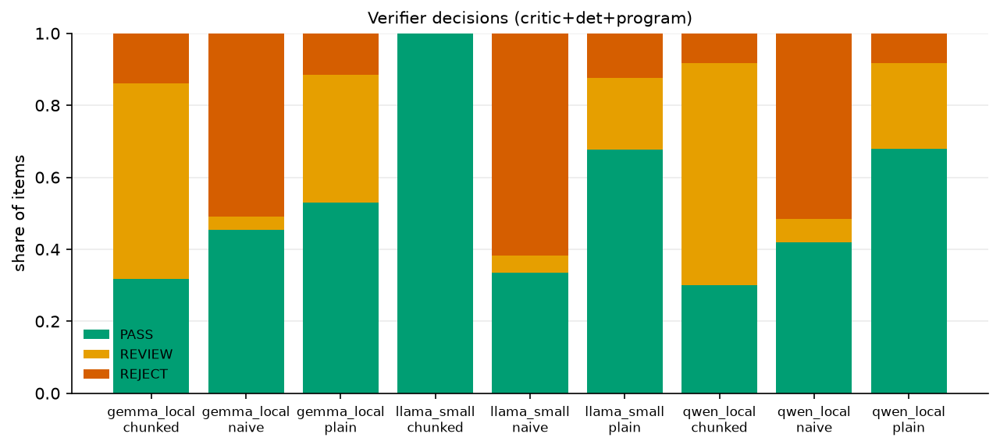
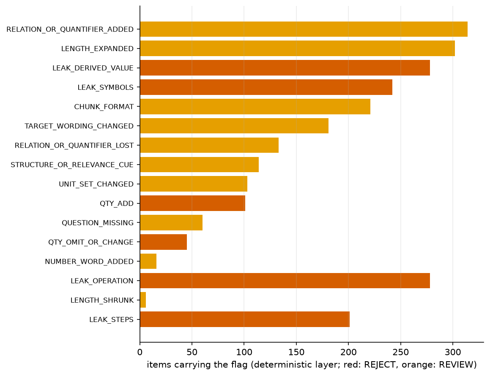
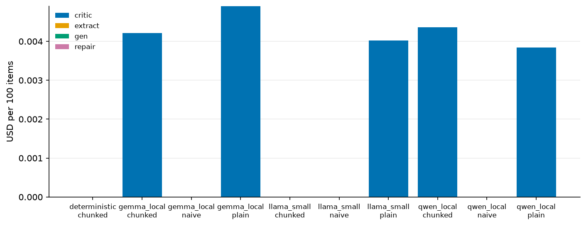
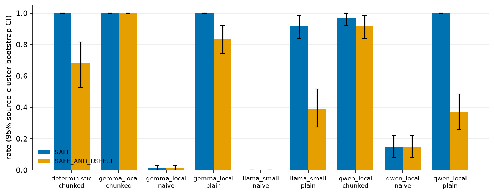
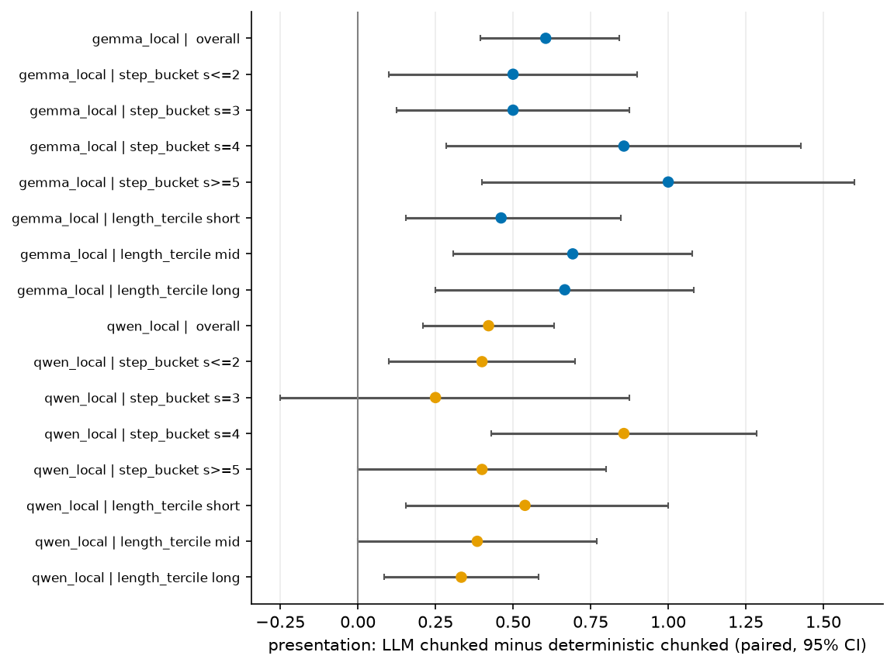
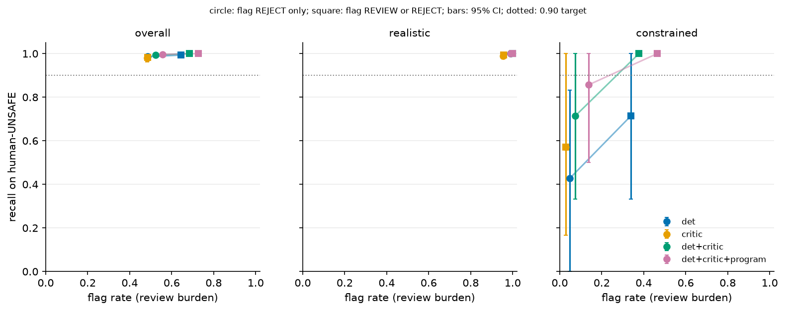
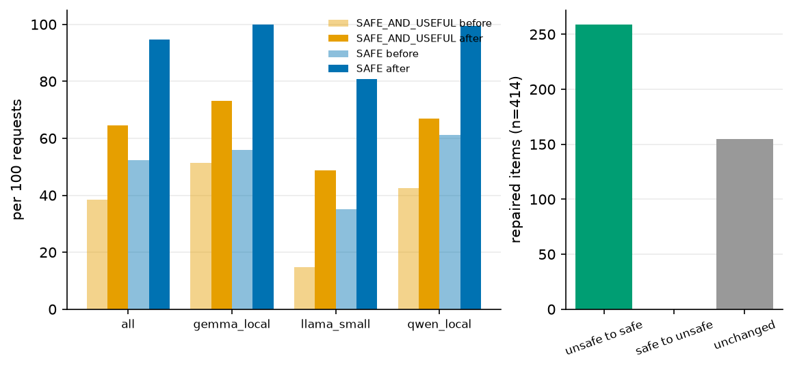

# Report: ollama-v1-standin

> **AI STAND-IN LABELS (mistral-small3.2:24b), NOT GROUND TRUTH.** Wherever this auto-generated report says "Human (adjudicated) labels", read "AI stand-in labels". Dry run of the methods only; see `STATUS_REPORT_2026-11-20.md`.

## Outputs per condition

Rows by source file (`main`, `ablation`, `pilot`, `repair`, `baseline`). `rewritten` and `no_rewrite` come from the model's own status field; `parse_error` means the reply was not valid JSON; `api_error` means the call failed; `refusal` means the provider's safety system declined (stop_reason refusal); `empty` means an empty reply. Prespecified: refusals and empty replies are excluded from safety rates and reported here as their own rate per condition (a refusal gives the teacher nothing, which is a usefulness cost, not a safety failure).

| kind     | generator     | transformation   |   n |   rewritten |   no_rewrite |   free_text |   parse_error |   api_error |
|:---------|:--------------|:-----------------|----:|------------:|-------------:|------------:|--------------:|------------:|
| ablation | gemma_local   | naive            | 100 |           0 |            0 |         100 |             0 |           0 |
| ablation | llama_small   | naive            | 100 |           0 |            0 |         100 |             0 |           0 |
| ablation | qwen_local    | naive            | 100 |           0 |            0 |         100 |             0 |           0 |
| baseline | deterministic | chunked          | 124 |           0 |            0 |           0 |             0 |           0 |
| main     | gemma_local   | chunked          | 124 |         124 |            0 |           0 |             0 |           0 |
| main     | gemma_local   | plain            | 124 |         121 |            3 |           0 |             0 |           0 |
| main     | llama_small   | chunked          | 124 |           1 |            0 |           0 |           123 |           0 |
| main     | llama_small   | plain            | 124 |         109 |           14 |           0 |             1 |           0 |
| main     | qwen_local    | chunked          | 124 |         124 |            0 |           0 |             0 |           0 |
| main     | qwen_local    | plain            | 124 |         116 |            8 |           0 |             0 |           0 |
| pilot    | gemma_local   | chunked          |  10 |          10 |            0 |           0 |             0 |           0 |
| pilot    | gemma_local   | plain            |  10 |          10 |            0 |           0 |             0 |           0 |
| pilot    | llama_small   | chunked          |  10 |           0 |            0 |           0 |            10 |           0 |
| pilot    | llama_small   | plain            |  10 |           9 |            1 |           0 |             0 |           0 |
| pilot    | qwen_local    | chunked          |  10 |          10 |            0 |           0 |             0 |           0 |
| pilot    | qwen_local    | plain            |  10 |          10 |            0 |           0 |             0 |           0 |
| repair   | gemma_local   | chunked          |  67 |           0 |            0 |           0 |             0 |           0 |
| repair   | gemma_local   | naive            | 100 |           0 |            0 |           0 |             0 |           0 |
| repair   | gemma_local   | plain            |  66 |           0 |            0 |           0 |             0 |           0 |
| repair   | llama_small   | naive            | 100 |           0 |            0 |           0 |            27 |           0 |
| repair   | llama_small   | plain            |  42 |           0 |            0 |           0 |             5 |           0 |
| repair   | qwen_local    | chunked          |  73 |           0 |            0 |           0 |             0 |           0 |
| repair   | qwen_local    | naive            | 100 |           0 |            0 |           0 |             0 |           0 |
| repair   | qwen_local    | plain            |  37 |           0 |            0 |           0 |             0 |           0 |

## Verifier decisions

### Layers: critic+det+program

| generator   | transformation   |   PASS |   REVIEW |   REJECT |   n |
|:------------|:-----------------|-------:|---------:|---------:|----:|
| gemma_local | chunked          |     64 |      109 |       28 | 201 |
| gemma_local | naive            |     91 |        7 |      102 | 200 |
| gemma_local | plain            |    106 |       71 |       23 | 200 |
| llama_small | chunked          |      1 |        0 |        0 |   1 |
| llama_small | naive            |     58 |        8 |      107 | 173 |
| llama_small | plain            |    115 |       34 |       21 | 170 |
| qwen_local  | chunked          |     62 |      128 |       17 | 207 |
| qwen_local  | naive            |     84 |       13 |      103 | 200 |
| qwen_local  | plain            |    116 |       41 |       14 | 171 |

### Layers: det

| generator     | transformation   |   PASS |   REVIEW |   REJECT |   n |
|:--------------|:-----------------|-------:|---------:|---------:|----:|
| deterministic | chunked          |    116 |        8 |        0 | 124 |

## Deterministic flag codes

From the `critic+det+program` verification (1523 items); an item counts once per code.

| code                         | severity   |   n_items |   share |
|:-----------------------------|:-----------|----------:|--------:|
| RELATION_OR_QUANTIFIER_ADDED | REVIEW     |       314 |   0.206 |
| LENGTH_EXPANDED              | REVIEW     |       302 |   0.198 |
| LEAK_OPERATION               | REJECT     |       278 |   0.183 |
| LEAK_DERIVED_VALUE           | REJECT     |       278 |   0.183 |
| LEAK_SYMBOLS                 | REJECT     |       242 |   0.159 |
| CHUNK_FORMAT                 | REVIEW     |       221 |   0.145 |
| LEAK_STEPS                   | REJECT     |       201 |   0.132 |
| TARGET_WORDING_CHANGED       | REVIEW     |       181 |   0.119 |
| RELATION_OR_QUANTIFIER_LOST  | REVIEW     |       133 |   0.087 |
| STRUCTURE_OR_RELEVANCE_CUE   | REVIEW     |       114 |   0.075 |
| UNIT_SET_CHANGED             | REVIEW     |       103 |   0.068 |
| QTY_ADD                      | REJECT     |       101 |   0.066 |
| QUESTION_MISSING             | REVIEW     |        60 |   0.039 |
| QTY_OMIT_OR_CHANGE           | REJECT     |        45 |   0.030 |
| NUMBER_WORD_ADDED            | REVIEW     |        16 |   0.011 |
| LEAK_OPERATION               | REVIEW     |         8 |   0.005 |
| LENGTH_SHRUNK                | REVIEW     |         6 |   0.004 |
| LEAK_STEPS                   | REVIEW     |         2 |   0.001 |

## Readability (diagnostic only)

Flesch-Kincaid grade of the adaptation minus that of the source. These numbers are never part of the safety decision.

| generator   | transformation   |   n |   source_fkgl |   candidate_fkgl |   delta_fkgl |
|:------------|:-----------------|----:|--------------:|-----------------:|-------------:|
| gemma_local | chunked          | 201 |         5.403 |            4.143 |       -1.260 |
| gemma_local | naive            | 200 |         5.330 |            5.567 |        0.238 |
| gemma_local | plain            | 200 |         5.384 |            3.911 |       -1.473 |
| llama_small | chunked          |   1 |         3.640 |            4.010 |        0.370 |
| llama_small | naive            | 173 |         5.223 |            4.165 |       -1.058 |
| llama_small | plain            | 170 |         5.425 |            4.896 |       -0.530 |
| qwen_local  | chunked          | 207 |         5.401 |            4.395 |       -1.006 |
| qwen_local  | naive            | 200 |         5.330 |            3.813 |       -1.516 |
| qwen_local  | plain            | 171 |         5.417 |            5.021 |       -0.395 |

## Cost and latency

| stage   |   calls |   input_tokens |   output_tokens |   thinking_tokens |   usd |   mean_latency_s |
|:--------|--------:|---------------:|----------------:|------------------:|------:|-----------------:|
| critic  |    3563 |        2679510 |          789472 |                 0 | 0.029 |           10.077 |
| extract |    1107 |         461399 |          377627 |                 0 | 0.000 |           26.806 |
| gen     |    1228 |         344103 |          188527 |                 0 | 0.000 |            5.844 |
| repair  |     585 |         417526 |           64664 |                 0 | 0.000 |            4.748 |

## Outcome rates

Human (adjudicated) labels, first-pass outputs only. 95% percentile CIs from a source-clustered bootstrap (10000 replicates): all adaptations of one source are resampled together.

### SAFE

| model         | transformation   |   n |   k |   rate |   ci_lo |   ci_hi |
|:--------------|:-----------------|----:|----:|-------:|--------:|--------:|
| deterministic | chunked          |  38 |  38 |  1.000 |   1.000 |   1.000 |
| gemma_local   | chunked          |  62 |  62 |  1.000 |   1.000 |   1.000 |
| gemma_local   | naive            | 100 |   1 |  0.010 |   0.000 |   0.030 |
| gemma_local   | plain            |  62 |  62 |  1.000 |   1.000 |   1.000 |
| llama_small   | naive            | 100 |   0 |  0.000 |   0.000 |   0.000 |
| llama_small   | plain            |  62 |  57 |  0.919 |   0.839 |   0.984 |
| qwen_local    | chunked          |  62 |  60 |  0.968 |   0.919 |   1.000 |
| qwen_local    | naive            | 100 |  15 |  0.150 |   0.080 |   0.220 |
| qwen_local    | plain            |  62 |  62 |  1.000 |   1.000 |   1.000 |

### SAFE_AND_USEFUL

| model         | transformation   |   n |   k |   rate |   ci_lo |   ci_hi |
|:--------------|:-----------------|----:|----:|-------:|--------:|--------:|
| deterministic | chunked          |  38 |  26 |  0.684 |   0.526 |   0.816 |
| gemma_local   | chunked          |  62 |  62 |  1.000 |   1.000 |   1.000 |
| gemma_local   | naive            | 100 |   1 |  0.010 |   0.000 |   0.030 |
| gemma_local   | plain            |  62 |  52 |  0.839 |   0.742 |   0.919 |
| llama_small   | naive            | 100 |   0 |  0.000 |   0.000 |   0.000 |
| llama_small   | plain            |  62 |  24 |  0.387 |   0.274 |   0.516 |
| qwen_local    | chunked          |  62 |  57 |  0.919 |   0.839 |   0.984 |
| qwen_local    | naive            | 100 |  15 |  0.150 |   0.080 |   0.220 |
| qwen_local    | plain            |  62 |  23 |  0.371 |   0.258 |   0.484 |

### MATH_OK

| model         | transformation   |   n |   k |   rate |   ci_lo |   ci_hi |
|:--------------|:-----------------|----:|----:|-------:|--------:|--------:|
| deterministic | chunked          |  38 |  38 |  1.000 |   1.000 |   1.000 |
| gemma_local   | chunked          |  62 |  62 |  1.000 |   1.000 |   1.000 |
| gemma_local   | naive            | 100 |   6 |  0.060 |   0.020 |   0.110 |
| gemma_local   | plain            |  62 |  62 |  1.000 |   1.000 |   1.000 |
| llama_small   | naive            | 100 |   0 |  0.000 |   0.000 |   0.000 |
| llama_small   | plain            |  62 |  57 |  0.919 |   0.839 |   0.984 |
| qwen_local    | chunked          |  62 |  60 |  0.968 |   0.919 |   1.000 |
| qwen_local    | naive            | 100 |  43 |  0.430 |   0.340 |   0.530 |
| qwen_local    | plain            |  62 |  62 |  1.000 |   1.000 |   1.000 |

### NO_LEAK

| model         | transformation   |   n |   k |   rate |   ci_lo |   ci_hi |
|:--------------|:-----------------|----:|----:|-------:|--------:|--------:|
| deterministic | chunked          |  38 |  38 |  1.000 |   1.000 |   1.000 |
| gemma_local   | chunked          |  62 |  62 |  1.000 |   1.000 |   1.000 |
| gemma_local   | naive            | 100 |   1 |  0.010 |   0.000 |   0.030 |
| gemma_local   | plain            |  62 |  62 |  1.000 |   1.000 |   1.000 |
| llama_small   | naive            | 100 |   0 |  0.000 |   0.000 |   0.000 |
| llama_small   | plain            |  62 |  59 |  0.952 |   0.887 |   1.000 |
| qwen_local    | chunked          |  62 |  62 |  1.000 |   1.000 |   1.000 |
| qwen_local    | naive            | 100 |  15 |  0.150 |   0.080 |   0.220 |
| qwen_local    | plain            |  62 |  62 |  1.000 |   1.000 |   1.000 |

## Prespecified paired comparisons on SAFE

Three families (diff = A minus B): realistic vs constrained-chunked per generator, generator A vs B per transformation, plain vs chunked per generator. Exact McNemar on discordant pairs; Holm adjustment within each family only. Everything else is exploratory.

| family                           | comparison                         |   n_pairs |   diff |   ci_lo |   ci_hi |   A_only |   B_only |   mcnemar_p |   holm_p |
|:---------------------------------|:-----------------------------------|----------:|-------:|--------:|--------:|---------:|---------:|------------:|---------:|
| realistic_vs_constrained_chunked | gemma_local: naive vs chunked      |        50 | -0.980 |  -1.000 |  -0.940 |        0 |       49 |       0.000 |    0.000 |
| realistic_vs_constrained_chunked | qwen_local: naive vs chunked       |        50 | -0.820 |  -0.920 |  -0.700 |        1 |       42 |       0.000 |    0.000 |
| generator_A_vs_B                 | plain: gemma_local vs llama_small  |        62 |  0.081 |   0.016 |   0.161 |        5 |        0 |       0.062 |    0.312 |
| generator_A_vs_B                 | plain: gemma_local vs qwen_local   |        62 |  0.000 |   0.000 |   0.000 |        0 |        0 |       1.000 |    1.000 |
| generator_A_vs_B                 | plain: llama_small vs qwen_local   |        62 | -0.081 |  -0.161 |  -0.016 |        0 |        5 |       0.062 |    0.312 |
| generator_A_vs_B                 | chunked: gemma_local vs qwen_local |        62 |  0.032 |   0.000 |   0.081 |        2 |        0 |       0.500 |    1.000 |
| generator_A_vs_B                 | naive: gemma_local vs llama_small  |       100 |  0.010 |   0.000 |   0.030 |        1 |        0 |       1.000 |    1.000 |
| generator_A_vs_B                 | naive: gemma_local vs qwen_local   |       100 | -0.140 |  -0.210 |  -0.070 |        1 |       15 |       0.001 |    0.003 |
| generator_A_vs_B                 | naive: llama_small vs qwen_local   |       100 | -0.150 |  -0.220 |  -0.080 |        0 |       15 |       0.000 |    0.000 |
| plain_vs_chunked                 | gemma_local: plain vs chunked      |        62 |  0.000 |   0.000 |   0.000 |        0 |        0 |       1.000 |    1.000 |
| plain_vs_chunked                 | qwen_local: plain vs chunked       |        62 |  0.032 |   0.000 |   0.081 |        2 |        0 |       0.500 |    1.000 |

## Presentation versus the deterministic chunking baseline

Paired by source; abstentions (null presentation) are ignored. Wilcoxon signed-rank is a sensitivity check. Strata are exploratory.

| generator   | stratum_type   | stratum   |   n_pairs |   mean_llm |   mean_baseline |   diff |   ci_lo |   ci_hi |   wilcoxon_p |
|:------------|:---------------|:----------|----------:|-----------:|----------------:|-------:|--------:|--------:|-------------:|
| gemma_local | overall        | all       |        38 |      2.289 |           1.684 |  0.605 |   0.395 |   0.842 |        0.000 |
| gemma_local | step_bucket    | s<=2      |        10 |      2.200 |           1.700 |  0.500 |   0.100 |   0.900 |        0.125 |
| gemma_local | step_bucket    | s=3       |         8 |      2.250 |           1.750 |  0.500 |   0.125 |   0.875 |        0.125 |
| gemma_local | step_bucket    | s=4       |         7 |      2.286 |           1.429 |  0.857 |   0.286 |   1.429 |        0.125 |
| gemma_local | step_bucket    | s>=5      |         5 |      2.600 |           1.600 |  1.000 |   0.400 |   1.600 |        0.125 |
| gemma_local | length_tercile | short     |        13 |      2.077 |           1.615 |  0.462 |   0.154 |   0.846 |        0.062 |
| gemma_local | length_tercile | mid       |        13 |      2.385 |           1.692 |  0.692 |   0.308 |   1.077 |        0.016 |
| gemma_local | length_tercile | long      |        12 |      2.417 |           1.750 |  0.667 |   0.250 |   1.083 |        0.031 |
| qwen_local  | overall        | all       |        38 |      2.105 |           1.684 |  0.421 |   0.211 |   0.632 |        0.001 |
| qwen_local  | step_bucket    | s<=2      |        10 |      2.100 |           1.700 |  0.400 |   0.100 |   0.700 |        0.125 |
| qwen_local  | step_bucket    | s=3       |         8 |      2.000 |           1.750 |  0.250 |  -0.250 |   0.875 |        0.750 |
| qwen_local  | step_bucket    | s=4       |         7 |      2.286 |           1.429 |  0.857 |   0.429 |   1.286 |        0.062 |
| qwen_local  | step_bucket    | s>=5      |         5 |      2.000 |           1.600 |  0.400 |   0.000 |   0.800 |        0.500 |
| qwen_local  | length_tercile | short     |        13 |      2.154 |           1.615 |  0.538 |   0.154 |   1.000 |        0.062 |
| qwen_local  | length_tercile | mid       |        13 |      2.077 |           1.692 |  0.385 |   0.000 |   0.769 |        0.188 |
| qwen_local  | length_tercile | long      |        12 |      2.083 |           1.750 |  0.333 |   0.083 |   0.583 |        0.125 |

## Verifier layer ablations

Positive class = human UNSAFE. `FLAG_REJECT` flags only REJECT decisions; `FLAG_ANY` flags REVIEW or REJECT (its flag rate is the human-review burden). Layer sets are recomputed from the stored layer outputs.

| layers             | subset      | operating_point   |   tp |   fn |   fp |   tn |   recall_unsafe |   recall_lo |   recall_hi |   precision |   flag_rate |
|:-------------------|:------------|:------------------|-----:|-----:|-----:|-----:|----------------:|------------:|------------:|------------:|------------:|
| det                | realistic   | FLAG_REJECT       |  284 |    0 |   13 |    3 |           1.000 |       1.000 |       1.000 |       0.956 |       0.990 |
| det                | realistic   | FLAG_ANY          |  284 |    0 |   16 |    0 |           1.000 |       1.000 |       1.000 |       0.947 |       1.000 |
| det                | constrained | FLAG_REJECT       |    3 |    4 |   14 |  327 |           0.429 |       0.000 |       0.833 |       0.176 |       0.049 |
| det                | constrained | FLAG_ANY          |    5 |    2 |  113 |  228 |           0.714 |       0.333 |       1.000 |       0.042 |       0.339 |
| det                | overall     | FLAG_REJECT       |  287 |    4 |   27 |  330 |           0.986 |       0.972 |       0.997 |       0.914 |       0.485 |
| det                | overall     | FLAG_ANY          |  289 |    2 |  129 |  228 |           0.993 |       0.983 |       1.000 |       0.691 |       0.645 |
| critic             | realistic   | FLAG_REJECT       |  281 |    3 |    5 |   11 |           0.989 |       0.975 |       1.000 |       0.983 |       0.953 |
| critic             | realistic   | FLAG_ANY          |  282 |    2 |    5 |   11 |           0.993 |       0.982 |       1.000 |       0.983 |       0.957 |
| critic             | constrained | FLAG_REJECT       |    4 |    3 |    5 |  298 |           0.571 |       0.167 |       1.000 |       0.444 |       0.029 |
| critic             | constrained | FLAG_ANY          |    4 |    3 |    5 |  298 |           0.571 |       0.167 |       1.000 |       0.444 |       0.029 |
| critic             | overall     | FLAG_REJECT       |  285 |    6 |   10 |  309 |           0.979 |       0.962 |       0.993 |       0.966 |       0.484 |
| critic             | overall     | FLAG_ANY          |  286 |    5 |   10 |  309 |           0.983 |       0.967 |       0.997 |       0.966 |       0.485 |
| det+critic         | realistic   | FLAG_REJECT       |  284 |    0 |   13 |    3 |           1.000 |       1.000 |       1.000 |       0.956 |       0.990 |
| det+critic         | realistic   | FLAG_ANY          |  284 |    0 |   16 |    0 |           1.000 |       1.000 |       1.000 |       0.947 |       1.000 |
| det+critic         | constrained | FLAG_REJECT       |    5 |    2 |   18 |  285 |           0.714 |       0.333 |       1.000 |       0.217 |       0.074 |
| det+critic         | constrained | FLAG_ANY          |    7 |    0 |  110 |  193 |           1.000 |       1.000 |       1.000 |       0.060 |       0.377 |
| det+critic         | overall     | FLAG_REJECT       |  289 |    2 |   31 |  288 |           0.993 |       0.983 |       1.000 |       0.903 |       0.525 |
| det+critic         | overall     | FLAG_ANY          |  291 |    0 |  126 |  193 |           1.000 |       1.000 |       1.000 |       0.698 |       0.684 |
| det+critic+program | realistic   | FLAG_REJECT       |  284 |    0 |   13 |    3 |           1.000 |       1.000 |       1.000 |       0.956 |       0.990 |
| det+critic+program | realistic   | FLAG_ANY          |  284 |    0 |   16 |    0 |           1.000 |       1.000 |       1.000 |       0.947 |       1.000 |
| det+critic+program | constrained | FLAG_REJECT       |    6 |    1 |   37 |  266 |           0.857 |       0.500 |       1.000 |       0.140 |       0.139 |
| det+critic+program | constrained | FLAG_ANY          |    7 |    0 |  137 |  166 |           1.000 |       1.000 |       1.000 |       0.049 |       0.465 |
| det+critic+program | overall     | FLAG_REJECT       |  290 |    1 |   50 |  269 |           0.997 |       0.989 |       1.000 |       0.853 |       0.557 |
| det+critic+program | overall     | FLAG_ANY          |  291 |    0 |  153 |  166 |           1.000 |       1.000 |       1.000 |       0.655 |       0.728 |

## Constrained repair

| metric                    |   value |
|:--------------------------|--------:|
| n_originals               | 610.000 |
| n_repaired                | 414.000 |
| unsafe_to_safe            | 259.000 |
| safe_to_unsafe            |   0.000 |
| unchanged                 | 155.000 |
| unchanged_safe            | 151.000 |
| unchanged_unsafe          |   4.000 |
| mean_delta_presentation   |  -0.802 |
| n_delta_presentation      | 414.000 |
| safe_per100_before        |  52.295 |
| safe_per100_after         |  94.754 |
| safe_useful_per100_before |  38.361 |
| safe_useful_per100_after  |  64.426 |

| generator   |   n |   n_repaired |   safe_per100_before |   safe_per100_after |   safe_useful_per100_before |   safe_useful_per100_after |
|:------------|----:|-------------:|---------------------:|--------------------:|----------------------------:|---------------------------:|
| gemma_local | 224 |          164 |               55.804 |             100.000 |                      51.339 |                     73.214 |
| llama_small | 162 |           92 |               35.185 |              80.864 |                      14.815 |                     48.765 |
| qwen_local  | 224 |          158 |               61.161 |              99.554 |                      42.411 |                     66.964 |

## Rates for every condition (PPI++ where a condition is partly labelled)

Prespecified (2026-11-15, lean labelling): human labels on a stratified sample of source problems, plus the primary verifier's decision on every output as the predictor. `classical` uses labelled items only; `ppi`/`ppipp` add the unlabelled ones (Angelopoulos et al. 2023; PPI++). Rates are UNSAFE = 1 - SAFE. Fully labelled conditions (realistic prompt) give classical = PPI. Hypothesis tests above use labelled items only.

| transformation   | generator     |   n_lab |   n_all |   f_rate_all |   classical |   classical_lo |   classical_hi |   classical_width |     ppi |   ppi_lo |   ppi_hi |   ppi_width |   ppipp |   ppipp_lo |   ppipp_hi |   ppipp_width |     lam |
|:-----------------|:--------------|--------:|--------:|-------------:|------------:|---------------:|---------------:|------------------:|--------:|---------:|---------:|------------:|--------:|-----------:|-----------:|--------------:|--------:|
| all              | all           |     648 |    1044 |        0.568 |       0.449 |          0.402 |          0.498 |             0.096 |   0.124 |    0.052 |    0.198 |       0.146 |   0.369 |      0.326 |      0.415 |         0.089 |   0.246 |
| chunked          | deterministic |      38 |     124 |        0.065 |       0.000 |          0.000 |          0.000 |             0.000 |  -0.059 |   -0.176 |    0.040 |       0.216 |   0.000 |      0.000 |      0.000 |         0.000 |   0.000 |
| chunked          | gemma_local   |      62 |     124 |        0.540 |       0.000 |          0.000 |          0.000 |             0.000 |   0.048 |   -0.129 |    0.226 |       0.355 |   0.000 |      0.000 |      0.000 |         0.000 |   0.000 |
| chunked          | llama_small   |       0 |       1 |        0.000 |     nan     |        nan     |        nan     |           nan     | nan     |  nan     |  nan     |     nan     | nan     |    nan     |    nan     |       nan     | nan     |
| chunked          | qwen_local    |      62 |     124 |        0.589 |       0.032 |          0.000 |          0.081 |             0.081 |  -0.048 |   -0.226 |    0.113 |       0.339 |   0.030 |     -0.004 |      0.079 |         0.083 |   0.026 |
| naive            | gemma_local   |     100 |     100 |        1.000 |       0.990 |          0.970 |          1.000 |             0.030 |   0.990 |    0.970 |    1.000 |       0.030 |   0.990 |      0.970 |      1.000 |         0.030 |   0.000 |
| naive            | llama_small   |     100 |     100 |        1.000 |       1.000 |          1.000 |          1.000 |             0.000 |   1.000 |    1.000 |    1.000 |       0.000 |   1.000 |      1.000 |      1.000 |         0.000 |   0.000 |
| naive            | qwen_local    |     100 |     100 |        1.000 |       0.850 |          0.780 |          0.920 |             0.140 |   0.850 |    0.780 |    0.920 |       0.140 |   0.850 |      0.780 |      0.920 |         0.140 |   0.000 |
| plain            | gemma_local   |      62 |     124 |        0.532 |       0.000 |          0.000 |          0.000 |             0.000 |   0.032 |   -0.129 |    0.210 |       0.339 |   0.000 |      0.000 |      0.000 |         0.000 |   0.000 |
| plain            | llama_small   |      62 |     123 |        0.341 |       0.081 |          0.016 |          0.145 |             0.129 |   0.054 |   -0.108 |    0.216 |       0.324 |   0.078 |      0.015 |      0.148 |         0.132 |   0.113 |
| plain            | qwen_local    |      62 |     124 |        0.298 |       0.000 |          0.000 |          0.000 |             0.000 |  -0.016 |   -0.177 |    0.145 |       0.323 |   0.000 |      0.000 |      0.000 |         0.000 |   0.000 |

## Checker version sensitivity (v1.1 vs v1.0-style rules)

Checker v1.1 was tuned on the 10 dev problems only. This table re-decides the same stored outputs with the two v1.0 rules that v1.1 relaxed restored (relation types differing while answers match -> REVIEW; a new count written as a number word -> REJECT), so the effect of the tuning on recall and review burden is visible. The v1.1 synonym classes cannot be reversed offline and are not part of this comparison.

| rules            | subset      | operating_point   |   n |   recall_unsafe |   recall_lo |   recall_hi |   precision |   flag_rate |
|:-----------------|:------------|:------------------|----:|----------------:|------------:|------------:|------------:|------------:|
| v1.1 (as run)    | realistic   | FLAG_ANY          | 300 |           1.000 |       1.000 |       1.000 |       0.947 |       1.000 |
| v1.1 (as run)    | realistic   | FLAG_REJECT       | 300 |           1.000 |       1.000 |       1.000 |       0.956 |       0.990 |
| v1.1 (as run)    | constrained | FLAG_ANY          | 348 |           1.000 |       1.000 |       1.000 |       0.047 |       0.425 |
| v1.1 (as run)    | constrained | FLAG_REJECT       | 348 |           0.857 |       0.500 |       1.000 |       0.140 |       0.124 |
| v1.1 (as run)    | overall     | FLAG_ANY          | 648 |           1.000 |       1.000 |       1.000 |       0.650 |       0.691 |
| v1.1 (as run)    | overall     | FLAG_REJECT       | 648 |           0.997 |       0.989 |       1.000 |       0.853 |       0.525 |
| v1.0-style rules | realistic   | FLAG_ANY          | 300 |           1.000 |       1.000 |       1.000 |       0.947 |       1.000 |
| v1.0-style rules | realistic   | FLAG_REJECT       | 300 |           1.000 |       1.000 |       1.000 |       0.956 |       0.990 |
| v1.0-style rules | constrained | FLAG_ANY          | 348 |           1.000 |       1.000 |       1.000 |       0.036 |       0.560 |
| v1.0-style rules | constrained | FLAG_REJECT       | 348 |           0.857 |       0.500 |       1.000 |       0.136 |       0.126 |
| v1.0-style rules | overall     | FLAG_ANY          | 648 |           1.000 |       1.000 |       1.000 |       0.588 |       0.764 |
| v1.0-style rules | overall     | FLAG_REJECT       | 648 |           0.997 |       0.989 |       1.000 |       0.850 |       0.526 |

## Exploratory logistic regression of UNSAFE

**Exploratory, not one of the prespecified tests.** n = 610; Firth bias-reduced logit (separation in the ordinary fit); SE, CI and p from a source-cluster bootstrap.

| term                    |   coef |    se |      z |     p |   odds_ratio |     or_lo |      or_hi |
|:------------------------|-------:|------:|-------:|------:|-------------:|----------:|-----------:|
| const                   | -5.178 | 1.057 | -4.897 | 0.000 |        0.006 |     0.001 |      0.057 |
| n_steps                 |  0.167 | 0.244 |  0.683 | 0.395 |        1.181 |     0.727 |      1.951 |
| words_per10             | -0.251 | 0.205 | -1.227 | 0.150 |        0.778 |     0.507 |      1.139 |
| tag_percent             |  0.498 | 0.562 |  0.886 | 0.265 |        1.645 |     0.681 |      6.703 |
| tag_fraction            |  0.028 | 0.506 |  0.056 | 0.835 |        1.029 |     0.409 |      2.976 |
| tag_comparison          | -0.343 | 0.561 | -0.611 | 0.485 |        0.710 |     0.236 |      2.488 |
| tag_money               | -0.068 | 0.543 | -0.126 | 0.875 |        0.934 |     0.337 |      2.746 |
| tag_time                | -0.340 | 0.480 | -0.708 | 0.445 |        0.712 |     0.256 |      1.650 |
| tag_measure             |  0.398 | 0.667 |  0.597 | 0.450 |        1.490 |     0.435 |      5.228 |
| tag_conditional         |  0.430 | 0.482 |  0.893 | 0.325 |        1.538 |     0.628 |      4.004 |
| dataset_gsm1k           |  0.533 | 0.956 |  0.558 | 0.550 |        1.705 |     0.364 |     12.900 |
| dataset_gsm8k           |  1.094 | 0.791 |  1.383 | 0.255 |        2.985 |     0.507 |      9.408 |
| cond_gemma_local|naive  |  8.761 | 0.991 |  8.837 | 0.000 |     6382.803 |  2784.659 |  91737.219 |
| cond_gemma_local|plain  | -0.000 | 0.000 | -0.913 | 0.960 |        1.000 |     1.000 |      1.000 |
| cond_llama_small|naive  |  9.866 | 0.570 | 17.313 | 0.000 |    19264.400 | 15980.519 | 142908.443 |
| cond_llama_small|plain  |  2.451 | 0.570 |  4.299 | 0.015 |       11.598 |     2.961 |     27.836 |
| cond_qwen_local|chunked |  1.627 | 0.676 |  2.405 | 0.125 |        5.089 |     1.000 |     12.509 |
| cond_qwen_local|naive   |  6.301 | 0.504 | 12.513 | 0.000 |      544.877 |   379.845 |   2194.746 |
| cond_qwen_local|plain   | -0.000 | 0.000 | -0.906 | 0.950 |        1.000 |     1.000 |      1.000 |
