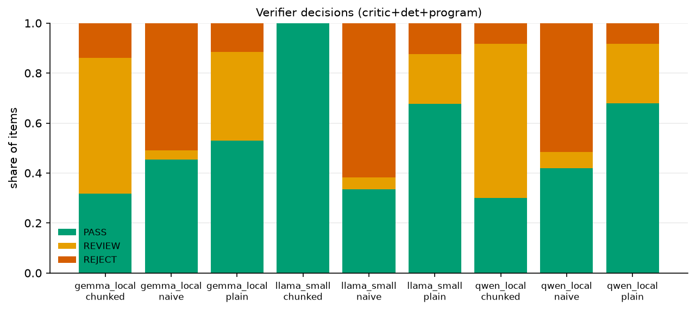
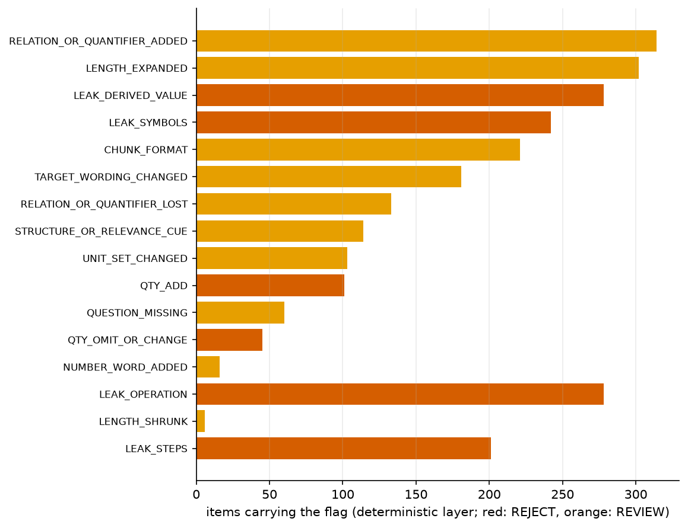
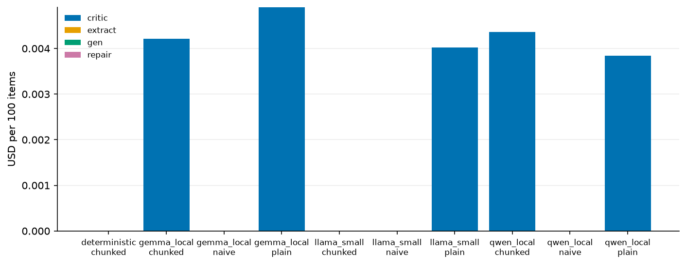

# Report: ollama-v1 (pipeline report, no human labels)

No adjudicated labels were supplied, so this report covers pipeline outputs only. It makes no claim about safety rates; those need human labels.

## Outputs per condition

Rows by source file (`main`, `ablation`, `pilot`, `repair`, `baseline`). `rewritten` and `no_rewrite` come from the model's own status field; `parse_error` means the reply was not valid JSON; `api_error` means the call failed; `refusal` means the provider's safety system declined (stop_reason refusal); `empty` means an empty reply. Prespecified: refusals and empty replies are excluded from safety rates and reported here as their own rate per condition (a refusal gives the teacher nothing, which is a usefulness cost, not a safety failure).

| kind     | generator     | transformation   |   n |   rewritten |   no_rewrite |   free_text |   parse_error |   api_error |
|:---------|:--------------|:-----------------|----:|------------:|-------------:|------------:|--------------:|------------:|
| ablation | gemma_local   | naive            | 100 |           0 |            0 |         100 |             0 |           0 |
| ablation | llama_small   | naive            | 100 |           0 |            0 |         100 |             0 |           0 |
| ablation | qwen_local    | naive            | 100 |           0 |            0 |         100 |             0 |           0 |
| baseline | deterministic | chunked          | 124 |           0 |            0 |           0 |             0 |           0 |
| main     | gemma_local   | chunked          | 124 |         124 |            0 |           0 |             0 |           0 |
| main     | gemma_local   | plain            | 124 |         121 |            3 |           0 |             0 |           0 |
| main     | llama_small   | chunked          | 124 |           1 |            0 |           0 |           123 |           0 |
| main     | llama_small   | plain            | 124 |         109 |           14 |           0 |             1 |           0 |
| main     | qwen_local    | chunked          | 124 |         124 |            0 |           0 |             0 |           0 |
| main     | qwen_local    | plain            | 124 |         116 |            8 |           0 |             0 |           0 |
| pilot    | gemma_local   | chunked          |  10 |          10 |            0 |           0 |             0 |           0 |
| pilot    | gemma_local   | plain            |  10 |          10 |            0 |           0 |             0 |           0 |
| pilot    | llama_small   | chunked          |  10 |           0 |            0 |           0 |            10 |           0 |
| pilot    | llama_small   | plain            |  10 |           9 |            1 |           0 |             0 |           0 |
| pilot    | qwen_local    | chunked          |  10 |          10 |            0 |           0 |             0 |           0 |
| pilot    | qwen_local    | plain            |  10 |          10 |            0 |           0 |             0 |           0 |
| repair   | gemma_local   | chunked          |  67 |           0 |            0 |           0 |             0 |           0 |
| repair   | gemma_local   | naive            | 100 |           0 |            0 |           0 |             0 |           0 |
| repair   | gemma_local   | plain            |  66 |           0 |            0 |           0 |             0 |           0 |
| repair   | llama_small   | naive            | 100 |           0 |            0 |           0 |            27 |           0 |
| repair   | llama_small   | plain            |  42 |           0 |            0 |           0 |             5 |           0 |
| repair   | qwen_local    | chunked          |  73 |           0 |            0 |           0 |             0 |           0 |
| repair   | qwen_local    | naive            | 100 |           0 |            0 |           0 |             0 |           0 |
| repair   | qwen_local    | plain            |  37 |           0 |            0 |           0 |             0 |           0 |

## Verifier decisions

### Layers: critic+det+program

| generator   | transformation   |   PASS |   REVIEW |   REJECT |   n |
|:------------|:-----------------|-------:|---------:|---------:|----:|
| gemma_local | chunked          |     64 |      109 |       28 | 201 |
| gemma_local | naive            |     91 |        7 |      102 | 200 |
| gemma_local | plain            |    106 |       71 |       23 | 200 |
| llama_small | chunked          |      1 |        0 |        0 |   1 |
| llama_small | naive            |     58 |        8 |      107 | 173 |
| llama_small | plain            |    115 |       34 |       21 | 170 |
| qwen_local  | chunked          |     62 |      128 |       17 | 207 |
| qwen_local  | naive            |     84 |       13 |      103 | 200 |
| qwen_local  | plain            |    116 |       41 |       14 | 171 |

### Layers: det

| generator     | transformation   |   PASS |   REVIEW |   REJECT |   n |
|:--------------|:-----------------|-------:|---------:|---------:|----:|
| deterministic | chunked          |    116 |        8 |        0 | 124 |

## Deterministic flag codes

From the `critic+det+program` verification (1523 items); an item counts once per code.

| code                         | severity   |   n_items |   share |
|:-----------------------------|:-----------|----------:|--------:|
| RELATION_OR_QUANTIFIER_ADDED | REVIEW     |       314 |   0.206 |
| LENGTH_EXPANDED              | REVIEW     |       302 |   0.198 |
| LEAK_OPERATION               | REJECT     |       278 |   0.183 |
| LEAK_DERIVED_VALUE           | REJECT     |       278 |   0.183 |
| LEAK_SYMBOLS                 | REJECT     |       242 |   0.159 |
| CHUNK_FORMAT                 | REVIEW     |       221 |   0.145 |
| LEAK_STEPS                   | REJECT     |       201 |   0.132 |
| TARGET_WORDING_CHANGED       | REVIEW     |       181 |   0.119 |
| RELATION_OR_QUANTIFIER_LOST  | REVIEW     |       133 |   0.087 |
| STRUCTURE_OR_RELEVANCE_CUE   | REVIEW     |       114 |   0.075 |
| UNIT_SET_CHANGED             | REVIEW     |       103 |   0.068 |
| QTY_ADD                      | REJECT     |       101 |   0.066 |
| QUESTION_MISSING             | REVIEW     |        60 |   0.039 |
| QTY_OMIT_OR_CHANGE           | REJECT     |        45 |   0.030 |
| NUMBER_WORD_ADDED            | REVIEW     |        16 |   0.011 |
| LEAK_OPERATION               | REVIEW     |         8 |   0.005 |
| LENGTH_SHRUNK                | REVIEW     |         6 |   0.004 |
| LEAK_STEPS                   | REVIEW     |         2 |   0.001 |

## Readability (diagnostic only)

Flesch-Kincaid grade of the adaptation minus that of the source. These numbers are never part of the safety decision.

| generator   | transformation   |   n |   source_fkgl |   candidate_fkgl |   delta_fkgl |
|:------------|:-----------------|----:|--------------:|-----------------:|-------------:|
| gemma_local | chunked          | 201 |         5.403 |            4.143 |       -1.260 |
| gemma_local | naive            | 200 |         5.330 |            5.567 |        0.238 |
| gemma_local | plain            | 200 |         5.384 |            3.911 |       -1.473 |
| llama_small | chunked          |   1 |         3.640 |            4.010 |        0.370 |
| llama_small | naive            | 173 |         5.223 |            4.165 |       -1.058 |
| llama_small | plain            | 170 |         5.425 |            4.896 |       -0.530 |
| qwen_local  | chunked          | 207 |         5.401 |            4.395 |       -1.006 |
| qwen_local  | naive            | 200 |         5.330 |            3.813 |       -1.516 |
| qwen_local  | plain            | 171 |         5.417 |            5.021 |       -0.395 |

## Cost and latency

| stage   |   calls |   input_tokens |   output_tokens |   thinking_tokens |   usd |   mean_latency_s |
|:--------|--------:|---------------:|----------------:|------------------:|------:|-----------------:|
| critic  |    3563 |        2679510 |          789472 |                 0 | 0.029 |           10.077 |
| extract |    1107 |         461399 |          377627 |                 0 | 0.000 |           26.806 |
| gen     |    1228 |         344103 |          188527 |                 0 | 0.000 |            5.844 |
| repair  |     585 |         417526 |           64664 |                 0 | 0.000 |            4.748 |

