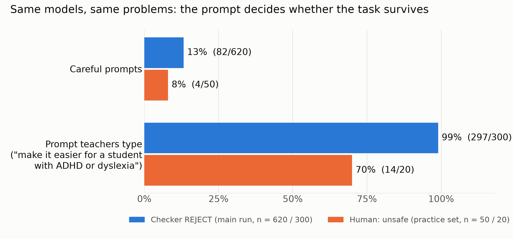
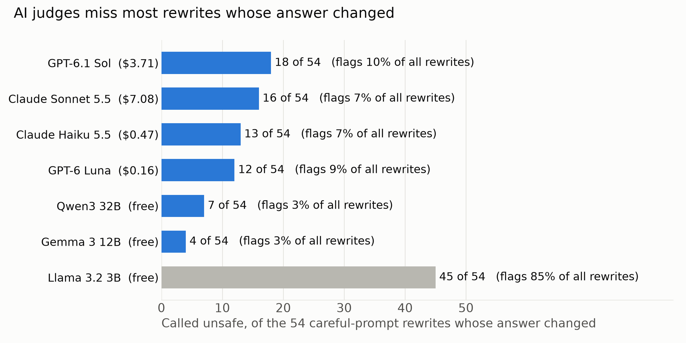

# SafeAdapt-Math — project video (Nov 23), 15 slides, ~16 min with narration

**Instructor's brief:**
- Same content as Nov 16: motivation, problem statement, approach, evaluation.
- A clear problem statement, with the main finding right after it.
- Few charts: two here; everything else is in `TECHNICAL_APPENDIX.md`.
- Add one ethics / broader-impact slide (slide 13).
- 15–17 minutes.

**Timing:** about 150 words per minute; the narration below is about 2,400 words. Times in brackets are targets.

**Accuracy rules:**
- Every number states its n.
- "Checker" numbers are automated decisions on the 1,044-rewrite main run.
- "Human" numbers are the 70 adjudicated calibration labels on 10 practice problems.
- Main-study human labels arrive Dec 1. The video says so, and quotes no stand-in (AI-labelled) numbers.

**Suggested split:** the first speaker does slides 1–5, the second does 6–15. Or one voice throughout.

---

## 1 · Title [0:20]
**SafeAdapt-Math: When "easier to read" becomes "easier to solve"**
Auditing AI accessibility rewrites of math word problems
Harshit Aggarwal · Cathy Liu · CS 2880 AI for Social Impact · Brown University · Nov 2026

> **Narration.** Hi, we're Harshit and Cathy. Our project audits something teachers already do every day: ask an AI to rewrite a math problem so a student with a disability can read it. We'll show that this often quietly changes the task, and we'll show what it takes to check for it.

---

## 2 · Motivation [1:20]
**Teachers already use AI to adapt assessments for students with disabilities. Nobody checks what it changes.**
- Students with IEPs and 504 plans are legally owed **accommodations**: the same task, made accessible (plain language, chunking).
- A **modification** makes the task easier. It is a different legal and educational category, and it changes what the grade means.
- Teachers are increasingly encouraged to use AI for this. No tool tells a teacher when a rewrite crossed the line.
- The failure is invisible: a rewrite that hands over the steps looks *more* helpful.
- The harm lands on the students the accommodation was meant to protect: grades that overstate mastery, and gaps found late.

> **Narration.** Roughly one in seven US public-school students receives special-education services under an IEP, and more have 504 plans. For them the law draws a careful line. An accommodation keeps the task the same and changes how it's presented: shorter sentences, one fact per line. A modification changes the task itself, and it changes what the grade certifies.
> Teachers are now told to use AI to produce accommodations, and that is a reasonable request. Rewriting a dense word problem is exactly what these models are good at. But nothing checks the output. The dangerous failure isn't a wrong answer that a teacher would notice. It's a rewrite that quietly does some of the thinking: it names the operation, or computes an intermediate value. That rewrite *looks* more supportive, so it's the one a busy teacher is most likely to approve. The cost falls on the students the accommodation was supposed to protect.
> Here's a concrete case. A student's IEP grants plain-language math tests. If the rewritten test names the operation for every problem, the student's score now measures something easier than the standard, and nobody — not the teacher, the parent, or the student — can tell from the grade.

---

## 3 · Problem statement [1:00]
**Given a math word problem and an AI rewrite of it, decide — automatically, at low cost, with a stated error guarantee — whether the rewrite is the same task: an accommodation, not a modification.**
- **Same task (fidelity):** every quantity, relation, condition and the question are preserved, so the answer is unchanged.
- **Nothing given away (no leakage):** no added steps, operations, relevance hints or derived values.
- We measure three things:
  1. **How often** rewrites change the task, with careful prompts and with the prompt teachers actually type.
  2. **How well** checkers catch it: rules, answer recomputation, and AI judges from free to frontier.
  3. **Whether** a school that can't pay for frontier models can get the same protection.

> **Narration.** Here is the problem in one sentence. Given a problem and its AI rewrite, decide automatically, cheaply, and with a stated error rate, whether the rewrite is still the same task.
> "Same task" has two parts. Fidelity: every number, relation, condition, and the question survive, so the answer is unchanged. And no leakage: the rewrite must not do any of the reasoning for the student.
> We ask three questions. How often does this go wrong? Can a checker catch it? And can a school with no budget get the same protection as one that can pay for frontier models?
> Why automatic, and why a guarantee? A teacher adapting a weekly worksheet may rewrite twenty or thirty problems, and a district tool may rewrite thousands. Nobody can re-solve every one by hand. And a checker that is right "most of the time" isn't enough for a legal accommodation. A district needs to be able to say: of the rewrites we let through, at most this fraction changes the task.

---

## 4 · Main finding, up front [1:10]
**The prompt teachers type turns most rewrites into modifications, and no AI judge reliably catches the subtle ones.**
1. **The prompt decides it.**
   - Careful prompts: the checker rejects 13% of rewrites (82/620), and humans rate 8% unsafe (4/50).
   - The realistic teacher prompt: the checker rejects 99% (297/300), and humans rate 70% unsafe (14/20).
2. **AI judges miss most real errors.** Of 54 careful-prompt rewrites whose answer recomputation shows a changed answer:
   - the best paid judge flags 18;
   - the best free large judge flags 7.
3. **The line is a human value judgement, and AI sides with the lenient reading.** Two human annotators split in one direction only, and both AI adjudication and AI labelling sided with the lenient annotator on the disputed cases.

> **Narration.** Our main finding, before the details. First: the risk lives in the prompt, not the model. With carefully written instructions, about one rewrite in eight is rejected by our checker. With the short prompt a teacher would actually type, "make this easier for a student with ADHD or dyslexia", 297 of 300 are rejected. Human labels on practice problems point the same way.
> Second: you can't fix this by asking another AI. On rewrites whose answer provably changed, the best paid judge we tested caught a third, and the best free one caught one in eight.
> Third: where people disagree about the line, the AIs we tried consistently took the lenient side. The rest of the talk is how we measured this and what a deployable safeguard looks like.

---

## 5 · What a "helpful" rewrite does [0:50]
**One example (practice problem, free 3B rewriter, plain-language prompt)**
- **Original:** "James builds a 20 story building. The first 10 stories are each 12 feet tall each. **The remaining floors are each 3 feet taller.** How tall is the building?"
- **Rewrite:** "…**The remaining 10 stories are 15 feet tall each.**"
- It reads more clearly, and it has done two steps for the student: 20 − 10 = 10 floors, and 12 + 3 = 15 feet.
- Verdicts:
  - Qwen 32B judge: SAFE.
  - Gemma 12B judge: SAFE.
  - Claude Haiku and GPT-6 Luna: UNSAFE.
  - Our free rule layer: **REJECT** (two derived values).

> **Narration.** Here's what this looks like. The original says the remaining floors are each 3 feet taller. The rewrite says the remaining 10 stories are 15 feet tall each. It is easier to read, and it has also done two computations the student was supposed to do. Two capable free AI judges called this safe; two paid ones didn't. A simple rule that looks for numbers that weren't in the original caught it. That pattern repeats across the study.

---

## 6 · Approach: measure → check → decide [0:50]
**Measure the failure, build a layered checker, then turn its verdicts into decisions with guarantees.**
- **Measure:**
  - real problems;
  - AI rewrites under careful and realistic prompts;
  - a non-AI control;
  - blind, double human labels as ground truth.
- **Check:** free rules → AI critic → recompute the answer as a program → PASS / REVIEW / REJECT.
- **Decide:**
  - a guaranteed-safe PASS threshold;
  - the cheapest order of checks;
  - label-efficient failure rates;
  - where a district should audit.
- Everything was prespecified and frozen before any study data was generated. Tuning used 10 separate practice problems only.

*Visual: three boxes, Measure → Check → Decide (as Nov 16).*

> **Narration.** Our approach has three parts. Measure the failure honestly, with a frozen design and blind human labels. Build a checker that combines cheap rules, an AI critic, and answer recomputation. And turn that checker into a decision procedure with statistical guarantees, because a verdict on its own is not a policy. All of it was fixed before we looked at study data. We tuned only on ten separate practice problems.
> Why layers? Each kind of check fails differently. Rules are cheap and exact, but only see what they're written for. AI critics read meaning, but can be persuaded by a fluent rewrite. Recomputation is objective, but only works when both versions can be turned into a program. Combining them, and knowing how each fails, is the design.

---

## 7 · Study design and the checker [1:15]
**1,044 AI rewrites of 124 problems, all checked on one university GPU, at $0**
- **Problems:** 124 from GSM8K test, ASDiv and GSM1K (a contamination check), stratified by solution steps × relational cues.
- **Conditions:**
  - careful plain-language and chunked prompts;
  - the realistic teacher prompt;
  - a non-AI sentence splitter as the control.
- **Rewriters:** three free open-weight models (Qwen 14B, Gemma 12B, Llama 3B).
- **Checker, three layers:**
  - **Rules:** quantities, relations, quantifiers, leaked operations and derived values. Free and deterministic.
  - **AI critic:** a rubric verdict with cited evidence.
  - **Program check:** extract both versions as programs and recompute. A different answer is a REJECT.
- **Judges compared:** 3 free local models and 4 paid frontier models (Claude Haiku and Sonnet 5.5, GPT-6 Luna and GPT-6.1 Sol). Paid spend: $11.42.

> **Narration.** The study uses 124 problems from three datasets, including GSM1K, which models are unlikely to have memorized. Each was rewritten by three free models under careful and realistic prompts, giving 1,044 rewrites. A sentence-splitting script with no AI is the control. The checker has three layers. Deterministic rules catch new numbers and lost relations. An AI critic gives a rubric verdict and must quote evidence. A program layer turns both versions into small programs, recomputes the answer, and rejects any rewrite whose answer changes. We then compared seven judges, three free and four paid, on the same rewrites. The paid ones cost us eleven dollars in total.
> For ground truth, we use a lean, prespecified labelling plan. Every realistic-prompt rewrite is labelled. Half of the careful-prompt problems are labelled, paired across models, so comparisons are fair. 30% of items are labelled by both annotators to measure agreement. That's 1,062 items in all, about 17 hours each, and the statistics on the next slides are designed to make the most of that budget.

---

## 8 · Result 1: the prompt decides it [1:30]
**Same models, same problems: careful prompts keep the task; the prompt teachers type breaks it.**

- The control (sentence splitter, no AI): **0 REJECT** of 124, so the rules don't fire on a faithful rewrite.
- What the realistic prompt adds, of 300 rewrites:
  - the operation to use (266);
  - precomputed values (260);
  - equations (239);
  - numbered solution steps (201).

> **Narration.** This is our first result. Blue is the checker on the full main run; orange is adjudicated human labels on the practice set. With careful prompts, 13% of rewrites are rejected and humans rate 8% unsafe. With the realistic prompt, almost everything is rejected, and humans rate 70% unsafe.
> When we look at what the realistic prompt adds, it's exactly scaffolding: the operation to use in 266 of 300 rewrites, precomputed values in 260, solution steps in 201. And the control, a script that only splits sentences, gets zero rejections, so the checker isn't just rejecting change.
> The takeaway: the more helpful the model tries to be, the more it modifies. A safeguard can't rely on teachers writing perfect prompts. It has to check the output.
> Two more checks on robustness. The pattern holds across rewriters: every one of the three models, given the realistic prompt, leaks on essentially every problem. And it holds across datasets: the rejection rate on GSM1K, which models are unlikely to have memorized, is 16%, against 13% on GSM8K. So this is not an artifact of a model having seen the test before.

---

## 9 · Result 2: AI judges miss most real errors [1:30]
**On the 54 careful-prompt rewrites where recomputation shows the answer changed, no AI judge catches most.**

- Paid judges catch 2–3× more than large free ones, but the best still misses 36 of 54.
- Price buys little: Haiku ($0.47) ≈ Sonnet ($7.08).
- Llama 3B "catches" 45 only by flagging 85% of everything. That is not a judge.
- Judges disagree with each other: Qwen 32B and Gemma 12B agree on only 4 of the rewrites they flag.

> **Narration.** Second result. We took the 54 careful-prompt rewrites where the program check shows the answer changed. These are clear errors, not judgment calls. How many does each AI judge flag? The best, GPT-6.1 Sol, flags 18. Claude Sonnet flags 16, at almost twenty times Haiku's cost for three more catches. The free large models catch 7 and 4. The small Llama model looks good until you notice it flags 85% of all rewrites, which would bury a teacher in false alarms.
> So an AI verdict is a useful signal, but not a decision. Rules and recomputation can't be talked into "this looks fine". In our system the AI critic is one layer, and human labels stay the ground truth.
> What do the judges miss? Mostly quiet changes. Our rules flag a relation or quantifier added in 43 of these careful-prompt rewrites and lost in 35: a comparison reworded, a condition dropped, a quantity moved to the wrong person. The rewrite still reads fluently, so a model asked "is this the same problem?" says yes. The program check doesn't read fluency. It recomputes.

---

## 10 · Result 3: the line is a value judgement, and AI picks the lenient side [1:15]
**Calibration: two blind annotators, 70 rewrites of 10 practice problems**
- **Human agreement on SAFE:** κ 0.79, 93% raw. All 5 SAFE disagreements run one way: one annotator strict, one lenient.
  - The disputed cases are subtle: an "If he ate half…" condition restated as a fact, a dangling "If…" fragment, and "Here is what you need to know".
- **An AI adjudicator sided with the lenient label on 5 of 5.** The project owner reviewed all 30 disagreements and overrode all 5 to UNSAFE (16 accepted, 14 overridden in total).
- **An AI labeller (Mistral 24B) agrees with the final labels at κ 0.79**, the same as the lenient annotator.
- We wrote the strict reading into the rubric (v1.2), with examples, before main-study labelling.

> **Narration.** Third result, and the one that surprised us. Before labelling the study, two of us labelled 70 practice rewrites independently. We agree well on SAFE, kappa 0.79. But every disagreement went the same way: one of us strict, one lenient. And the cases are subtle. Is turning "if he ate half the cookies, how many are left" into "he ate half the cookies" a faithful rewrite? We decided no: it drops a condition.
> We then tried AI for adjudication and for labelling. The AI adjudicator sided with the lenient label five times out of five. The AI labeller matched the lenient annotator, not the final labels. This is the same failure as the judges: AI reads a helpful-looking rewrite charitably. So our rubric now states the strict reading explicitly, and the final labels are human.
> This matters beyond our project. A lot of current evaluation uses one model to grade another. In our setting, the grading model shares the same bias as the rewriter: it rewards helpfulness. When the question is "did this become too helpful?", that bias points the wrong way.

---

## 11 · Result 4: what "free" buys a school [1:00]
**The whole pipeline runs at $0 on hardware a district or university already has, but only above a size threshold.**
- Free tier: one GPU, about 1.5 days for the whole study. Student materials never leave campus.
- **Small models break the output contract:**
  - Llama 3B produced a usable chunked rewrite for **1 of 124** problems, against 124/124 for Qwen 14B and Gemma 12B.
  - As a judge it flags 85% of everything.
- A small model isn't automatically cheap: the Qwen 4B critic was about 25× slower than the 32B, because it reasons until cut off.
- **Teacher time is the binding cost.** A REVIEW costs about 1.5 minutes. With careful prompts a third of rewrites go to REVIEW, and that is what the decision layer must shrink.
- Stability: 93% of regenerations are text-identical, and SAFE flipped on 2 of the 10 that changed.

> **Narration.** Fourth: equity. Everything we built runs for free on a single GPU, so a district doesn't need a frontier-model contract, and student materials never leave campus. But there's a floor. The 3-billion-parameter model couldn't follow the chunking format, 1 usable rewrite out of 124, and as a judge it flags almost everything. Small isn't automatically cheap either: the small reasoning model was 25 times slower than the large one.
> The real cost is teacher time. Every REVIEW is about a minute and a half, and with careful prompts a third of rewrites go to review. That's why the last part of the system matters.

---

## 12 · From checker to decision [1:00]
**A checker is not a policy. These turn it into one (built, tested, and run end to end; final numbers on human labels Dec 3).**
- **Guaranteed PASS** (conformal risk control / Learn-then-Test): "of what we pass, at most α is unsafe", with probability ≥ 1 − δ.
- **Label-efficient failure rates** (prediction-powered inference, stratum-weighted): unbiased rates from a labelled subset plus checker verdicts on everything.
- **Cost-aware cascade:** the cheapest ordering of rules → AI critic → human for a target safety level, reported as a Pareto frontier.
- **Where to audit** (a Stackelberg audit game): spend a district's limited audit budget where a lenient tool would do most harm.
- **Robustness:**
  - an iterated red-team attacker reduces held-out recall from 0.73 to 0.67 over three rounds (n = 15 per round);
  - in a synthetic test, weighted conformal keeps its guarantee under distribution shift and unweighted does not.

> **Narration.** A checker gives verdicts, but a school needs decisions with known risk. So we built a decision layer. Conformal risk control picks a threshold so that, among the rewrites we pass, at most a chosen fraction is unsafe. Prediction-powered inference estimates failure rates with fewer human labels. A cascade finds the cheapest order of checks for a target safety level. And a Stackelberg audit game, from this course, tells a district where to spend a limited audit budget. All of these run end to end. We've validated the pipeline and will report their final numbers once the human labels are in, on December 3rd. We've also tested robustness: a red-team attacker that learns to leak while passing the checker brings recall down modestly, and weighted conformal keeps its guarantee when the problem mix shifts.
> Two of these in plain words. Conformal risk control works like setting a passing bar on a practice exam. We use labelled rewrites to choose how confident the checker must be before we pass a rewrite, so that on new rewrites like these the unsafe share among passes stays below a target, say 5%. The audit game treats a district and a careless or adversarial vendor as players. The district can't audit everything, so it chooses audit rates per tool and prompt type so that the worst-case harm is as small as possible.

---

## 13 · Ethical implications and broader impact [1:30]
**Who could be helped, who could be harmed, and what we did about it**
- **Intended benefit:** fair access for students with disabilities. Teachers can use AI accommodations without silently lowering the bar, and districts can audit vendor tools.
- **Risks:**
  - **False reassurance.** A PASS is evidence, not proof. An over-trusted checker can launder modifications into IEP-compliant paperwork. Mitigations: the error guarantee is stated, REVIEW routes to a person, and humans stay the final authority.
  - **Whose line?** "Accommodation vs modification" is a value judgement. Our rubric encodes one strict reading from two annotators, not special-education teachers, students or families. It must be validated with them before any deployment.
  - **Over-blocking.** A strict checker can deny students a genuinely helpful rewrite. The cost of a false REJECT falls on the same students, so we report false alarms (REVIEW burden) alongside misses.
  - **Equity and privacy.** Cheaper models fail more often, so under-resourced schools carry more risk. Our free, on-campus tier keeps student materials local.
  - **Dual use.** The red-team attacker shows how to evade a checker. We release it as an evaluation tool.
- **Scope:** English, GSM-style arithmetic, one rubric and no student outcomes. Not yet evidence that any rewrite helps or harms learning.

> **Narration.** Some broader considerations. The benefit we're aiming for is simple: students with disabilities get the access they're owed without the task quietly getting easier, and districts get a way to audit tools.
> But there are real risks. The biggest is false reassurance. A checker that says PASS can turn a modification into compliant-looking paperwork. That's why we state an error guarantee, send uncertain cases to a person, and keep humans as the final authority.
> Second, the line itself is a value judgement. Our rubric reflects two annotators, not special-education teachers, students, or families, and it needs their validation before anyone deploys it.
> Third, strictness has a cost: blocking a helpful rewrite also hurts the student, so we report false alarms, not just catches.
> Fourth, equity: cheaper models fail more, so poorer schools carry more risk. Our free, on-campus option is meant to close that gap and keep student data local.
> Finally, the red-team attacker is dual-use, and we frame it strictly as an evaluation tool. And our scope is narrow: English, arithmetic word problems, no student outcomes.

---

## 14 · Limitations and what's next [0:45]
- **Main-study human labels:** 1,062 items, two blind annotators, due **Dec 1**; joint adjudication Dec 2–3.
- Then on human labels: final failure rates, the guaranteed-PASS threshold, the cascade frontier and the audit game. The final report follows.
- **Limitations:**
  - human labels so far cover 70 practice items;
  - the program check is uncheckable on about 8% of rewrites;
  - three rewriters only;
  - prompts in English.
- **Next:**
  - validate the rubric with special-education teachers;
  - test with students, to see whether "safe" rewrites actually help;
  - extend beyond arithmetic word problems.

> **Narration.** Where we are: the generation and checking are done. Human labels for the main study are due December 1st, and then every decision-layer result gets its final numbers. The main limitations today are that human labels cover 70 practice items, that recomputation can't check about 8% of rewrites, and that our scope is three rewriters on English arithmetic problems. Next, we want special-education teachers to validate the rubric, and a student study to see whether safe rewrites actually help.
> In short: the measurement and the checker are finished, the decision methods are built and tested, and the remaining step is the one that has to be human, the labels.

---

## 15 · Take-home [0:40]
- **The failure is real and common:** with the prompt teachers type, 297 of 300 rewrites gave away operations, values or steps.
- **AI can't grade AI here:** on rewrites whose answer provably changed, the best judge caught 18 of 54, and AI sided with the lenient reading on disputed cases.
- **What works:** rules plus answer recomputation, an AI critic as one signal, human labels as ground truth, and guarantees on what gets passed. It runs at $0 on a school's own hardware.
- **Same problem, easier to read, verified before it reaches a student.**

> **Narration.** To sum up. AI accessibility rewrites change the task far more often than they appear to, especially with the prompts teachers actually use. Another AI isn't a reliable referee for this: it misses most provable errors and leans lenient where humans disagree. What works is layered: cheap rules and answer recomputation, AI as one signal, humans as ground truth, and guarantees on what we pass, all runnable for free. Same problem, easier to read, and verified before it reaches a student. Thank you.
> The code, the frozen design, and every number in this talk are in our repository, with a technical appendix for anything we didn't have time to show.

---

### Recording checklist
- Use 1080p. The slide text must be readable on a laptop screen: no table smaller than about 20 pt (the main tables are in the appendix).
- Total length 15:30–16:30. Rehearse slides 9 and 13; they're the densest.
- Submit by **Nov 23, end of day**. Send `TECHNICAL_APPENDIX.md` (or its PDF) with the video.
